# SeldOS (Humboldt Kernel Project)
### Hardened 64-bit Operating System, Seld Not Linux Userspace & Mobile DOOM Edition
**Copyright (C) 2026 The SeldOS Sovereign Project / Humboldt Underground.**  
*Licensed under the GNU Affero General Public License v3 (AGPLv3) with Humboldt Sovereign Rider.*

<p align="center">
  <br>
  <b>Пингвин Гумбольдта в шапочке из фольги с Библией — официальный суверенный маскот SeldOS</b>
</p>

<p align="center">
  <a href="LICENSE"></a>
  
  
  
  
  
  
  
  
  
  
</p>

> [!IMPORTANT]
> **SeldOS — бескомпромиссная суверенная система с чистым ядром и аппаратным Zero-Trust.**  
> В системе нет ядра Linux, чужих рантаймов, демонов systemd или нагромождений glibc/musl. Система написана с нуля на ассемблере и C99. Открытая архитектура **RISC-V 64-bit (RV64GC)** выступает флагманским суверенным кремниевым стандартом (0 бэкдоров Ring -3, 0 закрытых микрокодов), а на x86_64 развернут активный комплекс подавления аппаратных закладок (карантин Intel ME / AMD PSP на PCI, Zero-Trust SHA-256 CSPRNG, THL Keystroke Jitter).

---

## 📑 Быстрая навигация по разделам

<details open>
<summary><b>Развернуть интерактивное оглавление документации</b></summary>

| Раздел | Тематика | Ключевые компоненты |
| :--- | :--- | :--- |
| 📜 [1. Манифест и философия](#1-манифест-и-архитектурная-философия-проекта) | Идеология и принципы | Суверенитет, маскот-пингвин, палитра Humboldt |
| 🗺️ [2. Архитектура ядра и память](#2-архитектура-ядра-и-карта-памяти) | Системный базис | Higher-Half Kernel, PML4, W^X, Mermaid-схема |
| ⚙️ [3. Внутренние подсистемы ядра](#3-внутренние-подсистемы-ядра) | Аппаратный слой | PMM, VMM, Fast Syscall, AC'97 DMA, e1000, SeldFS |
| 🐚 [4. Пользовательское пространство SNL](#4-пользовательское-пространство-snl-сельдь-не-линукс) | Ring 3 Userspace | `libsnl`, утилиты `/bin/*`, Оракул TempleOS |
| 🛡️ [5. Архитектура OpSec и Anti-Forensics](#5-архитектура-суверенного-opsec-и-anti-forensics-харденинга-tinfoil-hat-tails-openbsd) | Защитный комплекс | Seld-Pledge, Seld-Unveil, THL Jitter, DoD Wipe, Air-Gap Diode |
| 🌐 [6. Сетевой стек, SeldTLS 1.3 и Tor](#6-сетевой-стек-нативный-криптографический-протокол-seldtls-13-и-tor-browser) | Сетевой рубеж | In-Kernel TCP Desync, DoT, RFC 7858, SOCKS5 |
| 🕹️ [7. Мобильный DOOM и Touch HUD](#7-мобильный-doom-и-сенсорное-управление-virtual-touch-hud) | 3D-гейминг | Раскладка виртуального пульта, сенсорные зоны |
| 📱 [8. Запуск на ПК (BIOS / Live USB) и мобильных устройствах](#8-запуск-на-пк-bios--live-usb-и-мобильных-устройствах) | Реальное железо и эмуляция | Запуск через BIOS/CSM, Live USB (dd/Rufus), VirtualBox, Limbo, UTM |
| 🔨 [9. Сборка и тестирование на ПК](#9-сборка-и-тестирование-на-пк) | Разработка | Makefile, QEMU runner, верификационные тесты |
| ⚖️ [10. Лицензия](#10-лицензия) | Правовой статус | GNU Affero GPLv3 (AGPLv3) & Sovereign Rider |

</details>

---

## 1. Манифест и архитектурная философия проекта

**SeldOS** — бескомпромиссная 64-битная операционная система реального режима x86_64, спроектированная с чистого листа на ассемблере NASM и стандарте C99. Проект категорически отвергает современные тенденции многослойного абстрактного bloatware: в SeldOS нет ядра Linux, чужих рантаймов, неподконтрольных фоновых демонов или нагромождений glibc/musl. Каждый машинный цикл, регистр управления процессора (`CR0`, `CR2`, `CR3`, `CR4`), таблица дескрипторов (GDT/IDT/TSS), 4-уровневая таблица страниц PML4 и MSR-регистры управляются напрямую собственным кодом ядра.

### Инженерные принципы и системный базис:
- **Маскот проекта — Пингвин Гумбольдта (*Spheniscus humboldti*) в шапочке из фольги с Библией:**
  Подобно тому, как пингвин Tux стал символом Linux, а чертенок Beastie — символом BSD, пингвин Гумбольдта в шапочке из фольги со священным писанием в лапках выбран официальным маскотом SeldOS. Этот образ олицетворяет бескомпромиссную суверенную безопасность, параноидальную защиту личных данных (OpSec), бескомпромиссный анти-корпоративный копилефт (AGPLv3 Sovereign) и независимость от внешних корпоративных монополий.
  - Векторные исходники: [`seldos_logo.svg`](seldos_logo.svg) и компактный встроенный образ [`seldos_logo.svgz`](seldos_logo.svgz) (GZIP-сжатый векторный файл, 74 KiB).
  - Векторное изображение строго квантовано по **39-цветной палитре Humboldt Palette** (0 цветов вне системного реестра).
- **Низкоуровневое растровое квантование (Разрешение 680×334):**
  Вместо произвольных стандартных разрешений компьютерной индустрии, геометрия фреймбуфера 680×334 жестко оптимизирована под безмасштабный рендеринг растрового консольного шрифта $8 \times 16$ и локальность данных в кэше процессора:
  - **Ширина 680 px:** Точно $680 / 8 = 85$ символьных колонок. Стандартная 80-колоночная текстовая разметка размещается с фиксированным запасом в 5 колонок (40 пикселей) под системные индикаторы, маркеры состояния и отступы без дорогостоящих вычислений межсимвольных интервалов.
  - **Высота 334 px:** Точно 20 полноценных текстовых строк по 16 пикселей ($20 \times 16 = 320\text{ px}$) плюс аппаратно зафиксированная нижняя охранная полоса в 14 пикселей ($320 + 14 = 334\text{ px}$), используемая под статусную панель, разделители окон и системный буфер.
  - **Кэш-локальность и субмегабайтный линейный фреймбуфер:** Общий размер 32-битного кадрового буфера составляет $680 \times 334 \times 4\text{ байта} = 908{,}480\text{ байт}$ ($\approx 887.2\text{ KiB}$). Он целиком укладывается в непрерывный физический диапазон менее 1 МиБ (L2/L3 кэш современных процессоров), гарантируя молниеносный unaccelerated software blitting через `memmove`/`memcpy` без промахов кэша и без необходимости пересечения многомегабайтных MMIO-границ.
- **Фиксированная 39-цветная палитра (Humboldt Palette):**
  В видеоподсистеме зафиксирована детерминированная палитра из 39 цветов с прямым отображением в RGB32:
  - **0..15:** Полная совместимость со стандартной 16-цветной ANSI/VGA-палитрой для консольных утилит и терминальных эмуляторов.
  - **16..26:** Высококонтрастные эргономичные монохроматические и сигнальные токены (угольный фон `0x18181A`, аспидные панели `0x2A2D34`, чистый белый текст `0xF2F4F8`, теплый песочный `0xE5D9C5`, сигнальный красный `0xE0533C`), рассчитанные на идеальное считывание текста шрифтами 8×16 и 5×7 без субпиксельного сглаживания.
  - **27..38:** Расширенные спектральные токены (глубокий индиго, пелагический синий, акцентный циан, золотистая охра, базальтовый серый) для отрисовки TUI-интерфейсов, двухпанельного файлового менеджера, сетевых графиков и трансляции палитры DOOM.
- **Строгая аппаратная изоляция памяти (W^X & Privilege Separation):**
  - Разделение привилегий на уровне процессора: супервизор ядра работает в Ring 0 (CPL = 0), все программы пользователя — в Ring 3 (CPL = 3).
  - Аппаратное правило **W^X (Write XOR Execute)**: секции исполняемого кода `.text` имеют флаги `RX` (`User=1, Write=0, NX=0`), а секции данных, стека и кучи — `RW, NX` (`User=1, Write=1, NX=1`).
  - Активация `EFER.NXE` (бит 11 MSR `0xC0000080`) и `CR0.WP` (бит 16) защищает структуры ядра от перезаписи из супервизора.
  - Каждое обращение к пользовательским буферам в системных вызовах проходит строгую валидацию границ канонического адреса (`validate_user_buffer`).
- **Аппаратный гейткипинг бинарников и Air-Gap On-Demand (Zero-Trust Immunity):**
  - **Криптографическая аттестация ELF:** ядро в `elf_load_and_run` аппаратно проверяет SHA-256 каждого исполняемого файла перед загрузкой в адресное пространство и сверяет с белым списком доверенных утилит. Запуск недоверенных бинарников, модифицированных файлов и вредоносных пейлоадов блокируется на уровне Ring 0.
  - **Air-Gap On-Demand Network Shield:** сетевой трафик по умолчанию заглушен на уровне драйверов (`nic_send_packet` / `SYS_NET_TCP_CONNECT`). Временная аренда (lease) выдается исключительно доверенным бинарникам (`/bin/tor`, `/bin/download`) или интерактивным командам пользователя. Любые скрытые майнеры, сетевые черви и RAT-бэкдоры не могут передать ни единого байта.
- **Комплексный OpSec и Anti-Forensics Харденинг (Tinfoil Hat, Tails, OpenBSD):**
  - **Zero-on-Free (Защита от UAF и остаточных данных):** Автоматическая DoD-зачистка нулями полезной нагрузки освобождаемых блоков памяти в диспетчере ядра `kfree` (`kmalloc.c`) и в пользовательской библиотеке `free` (`libsnl/memory.c`).
  - **Zero-Trust CSPRNG & Entropy Whitening:** Полный отказ от слепого доверия процессорам Intel/AMD и их генератору RDRAND. Недоверенный аппаратный выход кремния принудительно смешивается со счетчиками тактов (RDTSC/RDTIME), энтропией памяти, SplitMix64 и отбеливается через криптографическую губку SHA-256.
  - **OpSec PCI Backdoor Quarantine (Intel ME / AMD PSP):** Аппаратный аудит шины PCI при старте ядра. При обнаружении интерфейсов аппаратных сопроцессоров Ring -3 (Intel Management Engine / AMD PSP) ядро принудительно обнуляет PCI Command Register (`cmd = 0`), отзывая Bus Master DMA и изолируя физическую память ядра от аппаратного шпионажа.
  - **Аппаратный RFC 7686 DNS Leak Guard:** Полный запрет отправки открытых UDP/TCP DNS-запросов для доменов `.onion` на уровне ядра (`net_dns_resolve`) и в userspace (`seld_dns_resolve`, `seld_dns_resolve_dot`). Попытки резолвинга немедленно сбрасываются с кодом `-9` без генерации сетевых пакетов.
  - **Криптографический TCP ISN и рандомизация эфемерных портов (RFC 6056):** Защита от фингерпринтинга и предсказания TCP-соединений с использованием ядра CSPRNG (`rng_get_u64()`) вместо последовательных счетчиков.
  - **Seld-Pledge Capability Sandboxing (`SYS_PLEDGE`, вектор 48):** Модель ограничения привилегий процессов (OpenBSD `pledge(2)`). Процесс может добровольно и необратимо ограничить свои системные вызовы битовой маской разрешений (`PLEDGE_STDIO`, `RPATH`, `WPATH`, `NET`, `DNS` и др.). Нарушение карается мгновенным завершением с кодом `-37` (EPERM).
  - **Seld-Unveil Filesystem Sandboxing (`SYS_UNVEIL`, вектор 51):** Модель изоляции файловой системы по путям в стиле OpenBSD `unveil(2)`. Процесс объявляет белый список разрешенных путей с флагами (`r` - чтение, `w` - запись, `x` - исполнение, `c` - создание). Вызов `unveil(NULL, NULL)` необратимо блокирует конфигурацию. Попытка доступа к неавторизованным путям пресекается ядром с отказом в доступе.
  - **THL Keystroke Timing Obfuscation & Jitter (`kernel/drivers/kbd.c`, векторы 52/53):** Защита от тайминг-атак и кейлоггерного профилирования пользователя в стиле Tinfoil Hat Linux. Прерывания клавиатуры не отдают сканкоды немедленно: сканкоды буферизируются и квантуются по таймеру PIT в пачки ~50 мс со случайным CSPRNG микро-джиттером (4..6 тиков), скрывая межлитерные интервалы ввода.
  - **Эфемерный спуфинг MAC-адреса:** Автоматическая генерация случайного локально администрируемого MAC-адреса для сетевого контроллера Gigabit Ethernet (e1000) при каждом старте ядра, предотвращающая аппаратный трекинг на канальном уровне.
  - **Cold-Boot & RAM Scrubbing Defense:** Гарантированная зачистка нулями всех свободных страниц физической памяти (`pmm_secure_wipe_all_free()`), принудительный сброс TCP-сессий и стирание видеопамяти VGA/FB при выключении (`poweroff`) и перезагрузке (`reboot`).
- **Сетевая архитектура без иллюзий (Реальные протоколы вместо мифов):**
  - Никаких фиктивных заявлений о «100% неуязвимости» или рекламных слоганов. Сетевая безопасность строится на строгой реализации стандартов:
  - Реализация SOCKS5 по RFC 1928 с адресным типом `ATYP=0x03` (Domain Name). При запросах через прокси целевые доменные имена (включая адреса `.onion`) передаются внутри SOCKS5-хэндшейка напрямую в upstream Tor-демон, исключая отправку открытых DNS-запросов через локальный UDP DNS-резолвер ядра (порт 53).
  - Эфемерное исполнение (RAM-Only): сетевой браузер `/bin/tor` работает исключительно в оперативной памяти, не сохраняет историю или кэш на накопитель SeldFS и затирает память нулями при завершении процесса.
  - Отсутствие встроенного интерпретатора JavaScript исключает класс критических RCE-уязвимостей JIT-компиляторов и отслеживание через Canvas/WebGL.
- **Суверенный манифест анти-проприетарщины (AGPLv3 Sovereign):** Бескомпромиссный сетевой копилефт и суверенный райдер. Полный запрет использования в системах государственной слежки (ЦРУ/АНБ/ТСПУ), запрет закрытых облачных форков и гарантия вечной открытости исходного кода.
- **Независимость Userspace (SNL — Seld Not Linux):** Собственное изолированное пользовательское окружение с микро-libc (`libsnl`), общающееся с ядром через нативный скоростной протокол MSR `SYSCALL`/`SYSRET`.
- **All-in-One Portable Gaming:** Нативный порт культового классического 3D-шутера **DOOM** с прямой адресацией линейного фреймбуфера, сенсорным оверлеем (Virtual HUD) для мобильных виртуальных машин (Android Limbo / iOS UTM / Termux) и единым компактным загрузочным ISO-образом на базе Ramdisk (Initrd).

### 🛡️ Матрица суверенных рубежей безопасности SeldOS
- [x] **Изоляция привилегий CPU**: Полное разделение Ring 0 (ядро) и Ring 3 (пользователь) через MSR `syscall`/`sysretq`
- [x] **Аппаратная W^X память**: Раздельные флаги страниц `RX` (код) и `RW, NX` (данные, стек, куча) с активацией `EFER.NXE`
- [x] **Zero-Trust CSPRNG Sponge**: Отбеливание вывода CPU RDRAND через SHA-256 против кремниевых бэкдоров
- [x] **PCI Backdoor Quarantine**: Автоматический отзыв Bus Master DMA у Intel ME (HECI) и AMD PSP на шине PCI
- [x] **Libre Silicon (RISC-V 64)**: Полноценный нативный порт ядра под RV64GC (Sv39 MMU) с 0 проприетарных микрокодов
- [x] **Seld-Pledge (`SYS_PLEDGE`)**: Одностороннее необратимое сужение прав системных вызовов в стиле OpenBSD `pledge(2)`
- [x] **Seld-Unveil (`SYS_UNVEIL`)**: Белый список путей ФС SeldFS с персистентным локом `unveil(NULL, NULL)`
- [x] **THL Keystroke Jitter**: Квантование сканкодов в пачки ~50 мс со случайным микро-джиттером CSPRNG (Tinfoil Hat Linux)
- [x] **Anti-Forensics RAM Scrubbing**: Автоматическое зануление памяти `free()` (Zero-on-Free) и стирание ОЗУ при выключении
- [x] **In-Kernel TCP Desync**: Аппаратное расщепление SNI и фейковые пакеты в ядре для обхода ТСПУ/DPI
- [x] **SeldTLS 1.3**: Нативный криптографический движок TLS 1.3 (RFC 8446) без OpenSSL и внешних библиотек
- [x] **RFC 7686 Guard**: Аппаратная блокировка открытых DNS-запросов для `.onion` доменов на уровне драйвера
- [x] **TempleOS OpSec Оракул**: Сакральный непрерывный дорийский кантус 290–680 Гц через кольцевой AC'97 DMA-буфер
- [x] **Air-Gap Data Diode**: Оптическая передача QR + акустический FSK Bell 202 ключ (0 мкс дрейфа TSC, Zero-BadUSB)
- [x] **Разрешение Парадокса Анонимности (Anti-Standout)**: Канонический p0f стек Linux 6.x (MSS, SACK, TS, WScale 7, IP ID=0), JA3/JA4 мимикрия под Firefox ESR и зачистка User-Agent/ICMP
- [x] **PCIe Zero-Trust DMA & Option ROM Lockdown**: Полный отзыв Bus Master DMA у неавторизованных PCIe-устройств и отключение Expansion ROM (защита от Thunderbolt-атак и Option ROM payload)
- [x] **Poisson Cover Traffic & Uniform Padding**: Квантование сетевых фреймов (128..1514B) и фоновый Пуассоновский шум DNS (150..450 мс) против тайминг-корреляции GPA/XKeyscore
- [x] **TEMPEST Video RF Dispersion**: Субпиксельный высокоэнтропийный дизеринг ($\pm 1..2$ LSB) для размытия электромагнитного радиоизлучения кабелей HDMI/VGA (защита от Van Eck Phreaking)
- [x] **Microarchitectural Flush**: Аппаратный барьер предсказателя ветвлений IBPB (`wrmsr 0x48`), сброс кэшей `wbinvd` и сброс TLB против утечек Spectre v2/MDS
- [x] **Acoustic Keystroke Shield Pinpad**: Динамически перемешиваемый PIN-пад (`/bin/pinpad`) с навигацией стрелками против направленных микрофонов прослушки
- [x] **Anti-Clock-Skew Normalization**: Виртуальный нулевой дрейф (0 PPM) тактового генератора TCP Timestamps с динамическим CSPRNG микро-дизерингом ($\pm 1..2$ мс), разрушающий удаленный фингерпринтинг кристалла
- [x] **In-Band Time & NTP Hard-Drop**: Безусловный сброс открытых UDP 123 (NTP) пакетов и получение сертифицированного сетевого времени из TLS/HTTP Date (0 сторонних пакетов)
- [x] **Zero-DHCP & Silent Boot Wire**: Полное отсутствие широковещательного DHCP и загрузочных ARP-запросов, поддержка статической конфигурации `ifconfig static` и Пуассоновской задержки первого пакета (`net delay`)
- [x] **Hardware Telemetry Sanitization**: Маскирование серийных номеров материнской платы, BIOS, батареи (0 циклов, 0000-0000) и блокировка прямого опроса ACPI/SMBus
- [x] **Humboldt Interactive Vi-Editor (`/bin/hi`)**: Модальный текстовый редактор в честь пингвина Гумбольдта (режимы Normal/Insert/Command, навигация `hjkl`, `:w`, `:q`, `:wq`, 680×334 FB)
- [x] **Пайпы, редиректы и скрипты в Shell**: Конвейеры произвольной длины (`|`), перенаправление вывода (`>`, `>>`) и ввода (`<`), переменные (`$PATH`, `$USER`, `$HOME`, `$?`, `export`, `env`), исполнение скриптов `sh script.sh`
- [x] **Утилиты потоковой обработки текста**: `/bin/grep` (флаги `-i`, `-v`, `-n`, `-c`, `-l`), `/bin/head`, `/bin/tail` (кольцевой RAM-буфер), `/bin/less` (постраничный пейджер 680×334)
- [x] **Управление процессами и сигналами**: Запуск в фоне (`command &`), утилита `/bin/kill <pid>` через сисколл `SYS_KILL`, хоткеи `Ctrl+C` (сброс строки) и `Ctrl+Z` (приостановка)
- [x] **Суверенный буфер обмена и передача данных**: `/bin/clip` (копирование/вставка в чистую RAM без записи на носители) и `/bin/drop` (Base64-интерчейндж через терминал без физических накопителей)
- [x] **Classic DOOM Engine**: 3D-шутер с переключением сенсорного пульта и ПК-режима терминала

### 📊 Метрики кодовой базы и аппаратные размеры системы (LOC & Binary Footprint)

SeldOS спроектирован по парадигме предельной лаконичности: ноль раздутых фреймворков, чужих рантаймов и скрытого оверхеда. Чистый рукописный C99 и ассемблер NASM контролируют аппаратную платформу напрямую.

#### Чистый объем кода операционной системы (без DOOM, Python, SVG, логов и словарей):

| Компонент | Языки программирования | Файлов исходников | Строк чистого кода (LOC) |
| :--- | :--- | :---: | :---: |
| **Ядро (`kernel/`)** | C99, NASM, Headers | 80 | **17 991** |
| **Библиотека `libsnl` (`userspace/libc/`)** | C99, Headers | 32 | **5 536** |
| **Утилиты Userspace (`userspace/bin/` без DOOM)** | C99, Headers | 44 | **12 581** |
| **ИТОГО чистый код ОС** | **C99 / NASM** | **156** | **36 108** |

#### Аппаратные размеры бинарников и образов:

| Артефакт | Путь к файлу | Размер на диске | Описание |
| :--- | :--- | :---: | :--- |
| **Бинарник ядра** | `build/kernel.bin` | **367 KiB** | Higher-Half ядро со всеми драйверами (VMM, PMM, e1000, AC'97, SeldFS, TCP/IP, SeldTLS, Seld-Pledge, Seld-Unveil) |
| **Все утилиты Userspace** | `build/bin/*` | **~1.5 MiB** | 28 суверенных утилит без DOOM (29 с DOOM): `/bin/init`, `/bin/sh`, `/bin/hi`, `/bin/grep`, `/bin/less`, `/bin/clip`, `/bin/drop`, `/bin/diode`, `/bin/tor` и др. |
| **Образ файловой системы SeldFS** | `build/disk.img` | **2.69 MiB** | Корневой том SeldFS (до 64 файлов в индексной таблице) со всеми бинарниками и словарем оракула `oracle.txt` |
| **Загрузочный гибридный ISO** | `build/seldos.iso` | **3.6 MiB** | Готовый к загрузке в VirtualBox/QEMU/Limbo/UTM образ без EFI/Mac bloat (ядро + initrd + eltorito) |

---

## 2. Архитектура ядра и карта памяти

Ядро построено по архитектуре **Higher-Half Kernel** с разделением на супервизорное пространство ядра и изолированное пользовательское пространство.

### Архитектурная диаграмма изоляции Ring 0 / Ring 3

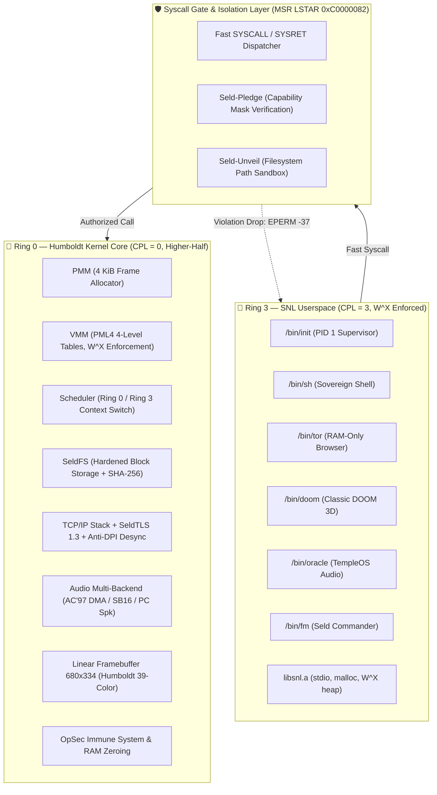

### Виртуальная карта памяти (Virtual Memory Map)
```
+-----------------------------------+  0xFFFFFFFFFFFFFFFF
|      Higher-Half Kernel Core      |  2 GiB (Текстовая секция, данные, BSS ядра)
+-----------------------------------+  0xFFFFFFFF80000000
|                ...                |  Каноническая дыра (Non-canonical space)
+-----------------------------------+  0xFFFF800040000000
|    HHDM (Direct Physical Map)     |  Прямой доступ к физической памяти (1 GiB)
+-----------------------------------+  0xFFFF800000000000
|                ...                |  Каноническая дыра (Non-canonical space)
+-----------------------------------+  0x00007FFFFFFFF000
|       Ring 3 Userspace Stack      |  Пользовательский стек (16 KiB, RW, NX, User)
+-----------------------------------+  0x00007FFFFFFFB000
|                ...                |
+-----------------------------------+  0x00000000A0000000
|   Linear Video Framebuffer (FB)   |  Проекция видеопамяти 680x334x32 (RW, NX, User)
+-----------------------------------+  0x00000000A00DE000
|                ...                |
+-----------------------------------+  0x0000000001000000
|       Ring 3 Userspace Heap       |  Куча процесса (SYS_BRK, RW, NX, User)
+-----------------------------------+  0x0000000000400000
|       Ring 3 Userspace Code       |  Исполняемый ELF-64 бинарник (RX, User)
+-----------------------------------+  0x0000000000000000
```

> [!NOTE]
> **Субмегабайтная локальность видеопамяти:** Полный объем линейного фреймбуфера 680×334×32 bpp составляет ровно **887.2 KiB**. Он целиком укладывается в кэш L2/L3 современных процессоров, обеспечивая программный блиттинг без промахов кэша и аппаратного ускорения.

---

## 3. Внутренние подсистемы ядра

### 3.1. Управление памятью (PMM, VMM & W^X)
- **PMM (Physical Memory Manager):**
  - Битовая карта фреймов (Bitmap-based allocator), оперирующая страницами размером 4096 байт (4 KiB).
  - Парсинг структуры памяти стандартов Multiboot 1 и Multiboot 2.
  - Автоматическое выявление и защита диапазонов In-Memory Ramdisk (Initrd).
  - Битовая карта размещается в физической памяти сразу за ядром и адресуется через HHDM-шлюз `0xFFFF800000000000 + phys`.
- **VMM (Virtual Memory Manager) & W^X Enforcement:**
  - 4-уровневая структура страниц x86_64: `PML4 -> PDPT -> Page Directory -> Page Table`.
  - Постраничное динамическое связывание с автоаллокацией промежуточных таблиц.
  - Аппаратная реализация правила **W^X (Write XOR Execute)**:
    - Секция `.text`: `Present`, `User=0`, `Write=0`, `NX=0` (Исполнение разрешено, запись запрещена).
    - Секция `.rodata`: `Present`, `User=0`, `Write=0`, `NX=1` (Только чтение, исполнение запрещено).
    - Секции `.data` и `.bss`: `Present`, `User=0`, `Write=1`, `NX=1` (Чтение и запись разрешены, исполнение запрещено).
  - Активация бита `EFER.NXE` (bit 11) в MSR `0xC0000080` и защита страниц от перезаписи супервизором через `CR0.WP` (bit 16).
- **Kernel Dynamic Heap (`kmalloc` / `kfree`):**
  - Связный список блоков (First-Fit Free List) с заголовками `struct block_header` и проверкой целостности через `KMALLOC_MAGIC` (`0x5E1DCAFE`).
  - Стартовый пул аллокатора оптимизирован до 256 КиБ (64 фрейма) в защищенном HHDM-сегменте с поддержкой динамического авторасширения (`heap_grow`) через PMM при исчерпании свободных блоков.
  - **Zero-on-Free (Kernel RAM Sanitization):** каждый вызов `kfree()` принудительно затирает память блока нулями `memset(hdr + 1, 0, hdr->size)` до маркировки блока свободным, исключая утечку криптографических ключей, сетевых пакетов и структур ядра через Use-After-Free.
- **Cold-Boot & RAM Scrubbing Defense (`pmm_secure_wipe_all_free`):**
  - При выключении (`poweroff`) и перезагрузке (`reboot`) ядро сканирует физическую битовую карту и перезаписывает нулями каждый свободный 4 КиБ фрейм через прямое HHDM-отображение. Это нейтрализует физические атаки с заморозкой чипов DRAM (Cold-Boot Attacks) и последующим снятием дампов памяти.

### 3.2. Сегментация, прерывания и системные вызовы
- **GDT (Global Descriptor Table) & TSS:**
  - Загружается в Higher-Half до инициализации подсистемы прерываний, предотвращая сбои двойного/тройного отказа:
    - `0x08`: 64-bit Kernel Code (DPL 0, RX)
    - `0x10`: Kernel Data (DPL 0, RW)
    - `0x18`: User Data Segment (DPL 3, RW, RPL 3 = `0x1B`)
    - `0x20`: 64-bit User Code Segment (DPL 3, RX, RPL 3 = `0x23`)
    - `0x28`: 16-байтный системный дескриптор 64-битного Task State Segment (TSS).
  - `TSS.RSP0`: Автоматический аппаратный переход на защищенный стек супервизора при прерываниях из Ring 3.
- **IDT (Interrupt Descriptor Table):**
  - Полная таблица из 256 шлюзов прерываний (Interrupt Gates).
  - Переназначение векторов ведущего (Master) и ведомого (Slave) контроллеров Intel 8259 PIC на векторы `0x20`–`0x2F` (IRQs 0..15).
  - Обработчики исключений процессора (0..31), включая `#GP` (13) и `#PF` (14) с декодированием регистра `CR2`.
- **Fast SYSCALL / SYSRET Subsystem:**
  - Быстрый интерфейс входа в ядро через инструкцию `syscall` (без оверхеда шлюзов прерываний).
  - MSR `STAR` (`0xC0000081`): Базовые селекторы `0x08` (Ring 0) и `0x10` (Ring 3 SYSRET: CS=`0x20|3`, SS=`0x18|3`).
  - MSR `LSTAR` (`0xC0000082`): Прямой указатель на ассемблерный диспетчер `syscall_entry_asm`.
  - MSR `FMASK` (`0xC0000084`): Автоматический сброс флага `IF` при системном вызове.
  - Сохранение регистров `r8`..`r15`, пользовательского указателя стека и возврат контекста через `sysretq`.
  - **Seld-Pledge Sandboxing (`SYS_PLEDGE`, вектор 48):** Нативный механизм ограничения возможностей процессов в стиле OpenBSD `pledge(2)`. Процесс объявляет разрешенные категории системных вызовов (`PLEDGE_STDIO`, `RPATH`, `WPATH`, `EXEC`, `NET`, `DNS`, `AUDIO` и др.). Битовая маска может только сужаться; любая попытка вызова за пределами маски немедленно прерывается с ошибкой `-37` (`EPERM`).
  - **Seld-Unveil Sandboxing (`SYS_UNVEIL`, вектор 51):** Изоляция файловой системы по путям в стиле OpenBSD `unveil(2)`. Наложение гранулярных ограничений (`UNVEIL_READ`, `UNVEIL_WRITE`, `UNVEIL_EXEC`, `UNVEIL_CREATE`). Вызов `seld_unveil(NULL, NULL)` необратимо блокирует правила для процесса и дочерних задач.
  - **THL Keystroke Timing Jitter (`SYS_OPSEC_SET_JITTER` 52, `SYS_OPSEC_GET_JITTER` 53):** Системное переключение и опрос статуса рандомизированного квантования сканкодов клавиатуры.

### 3.3. Драйверы периферии и устройств ввода
- **PS/2 Мышь и сенсорный экран (`kernel/drivers/mouse.c`, IRQ 12):**
  - Поддержка стандартного контроллера 8042 Aux/PS/2.
  - Декодирование 3-байтовых пакетов данных, абсолютные координаты $X, Y$ (0..680, 0..334), смещения $\Delta X, \Delta Y$ и статус кнопок.
  - Кольцевой буфер событий мыши на 128 элементов, неблокирующий системный вызов `SYS_POLLMOUSE` (вектор 27).
- **PS/2 Клавиатура (`kernel/drivers/kbd.c`, IRQ 1):**
  - Буфер сырых сканкодов для терминала и игровых движков, неблокирующий опрос `SYS_POLLKEY` (вектор 26).
  - **THL Keystroke Timing Obfuscation & Jitter (Tinfoil Hat Linux):** Защита от тайминг-атак деанонимизации и кейлоггеров. При включении режима (`jitter on` / `SYS_OPSEC_SET_JITTER`) поступающие сканкоды не передаются моментально, а накапливаются в промежуточной очереди (`kbd_stage_buf`) и квантуются пачками ~50 мс по тикам таймера PIT с микро-джиттером 4..6 тиков через CSPRNG (`rng_get_u64()`), полностью смазывая уникальный тайминг печати оператора. При отключении выполняется мгновенный flush без потерь.
- **VGA Text & Linear Framebuffer (`kernel/drivers/vga.c`):**
  - Текстовый буфер VGA 80x25 (`0xB8000`) для ранней загрузочной консоли.
  - Линейный 32-битный графический фреймбуфер высокого разрешения 680×334 с поддержкой Bochs/QEMU BGA (порты `0x01CE` / `0x01CF`) и Multiboot 1/2.
  - Аппаратное конфигурирование линейного видеорежима 680×334×32 bpp (pitch 2720 байт, 85×20 символьный растр + 14 px статусная полоса).
  - Архитектура изолированного консольного скроллинга через `fb_console_rows` и системный вызов `SYS_SET_CONSOLE_ROWS` (вектор 30).
  - Системный вызов `SYS_FRAMEBUFFER` (вектор 25) для прямого проецирования физической видеопамяти в Ring 3.
- **Хранилище: Ramdisk (Initrd) & ATA PIO:**
  - **In-Memory Ramdisk (`kernel/drivers/ramdisk.c`):** Автоматический захват и чтение загрузочного диска из памяти через Multiboot 1/2 модуль на гигабайтных скоростях.
  - **Динамическое расширение в RAM (`ramdisk_expand_in_ram`):** Ультракомпактный дистрибутивный ISO (~3.6 МБ) за счет упаковки только занятых секторов SeldFS (~2.69 МБ) и XZ-сжатия модулей GRUB. При старте ядра (`pmm_init`) поддерживается разреженная запись On-Demand до 34 МБ (69 632 секторов), обеспечивая полную поддержку записи в SeldFS на лету (скачивание Tor, сохранение конфигураций и данных) даже на минимальном объеме RAM.
  - **ATA PIO Driver (`kernel/drivers/ata.c`):** Драйвер первичного IDE контроллера в режиме 28-bit LBA (I/O порты `0x1F0`–`0x1F7`) для физических накопителей.
- **Файловая система SeldFS (`kernel/fs/seldfs.c`):**
  - Собственная компактная отказоустойчивая файловая система со структурой тома:
    - Sector 0: `Superblock` (Magic `0x5E1DF501`, счетчики блоков, размер, SHA-256).
    - Sector 1..16: `Block Allocation Bitmap` (битовая карта блоков данных).
    - Sector 17..32: `Inode Table` (метаданные файлов, размер, LBA первого блока).
    - Sector 33+: `Data Blocks`.
  - Универсальный блочный слой (`bdev_read_sectors` / `bdev_write_sectors`) — прозрачная работа поверх Ramdisk в памяти или физического диска ATA.

### 3.4. Фиксированная 39-цветная палитра и геометрия фреймбуфера 680×334

#### Таблица 39-цветной палитры SeldOS (Humboldt 39-Color Palette)
Палитра жестко закодирована в ядре (`kernel/drivers/vga.c`) и экспортируется через заголовочные файлы `vga.h` и `seld.h`. Каждая группа цветов несет строгое функциональное назначение в системном интерфейсе и TUI-приложениях:

<details>
<summary><b>🎨 Развернуть полную таблицу 39 токенов Humboldt Palette (RGB32)</b></summary>

| Индекс | HEX (RGB32) | Название константы | Техническое назначение и UI-роль |
| :---: | :---: | :--- | :--- |
| **0** | `0x00000000` | `VGA_BLACK` | Черный (Базовый фон VGA-консоли) |
| **1** | `0x000000AA` | `VGA_BLUE` | Синий (Стандартный ANSI Blue) |
| **2** | `0x0000AA00` | `VGA_GREEN` | Зеленый (Стандартный ANSI Green / статус OK) |
| **3** | `0x0000AAAA` | `VGA_CYAN` | Циан (Стандартный ANSI Cyan) |
| **4** | `0x00AA0000` | `VGA_RED` | Красный (Стандартный ANSI Red / ошибки) |
| **5** | `0x00AA00AA` | `VGA_MAGENTA` | Маджента (Стандартный ANSI Magenta) |
| **6** | `0x00AA5500` | `VGA_BROWN` | Коричневый (Стандартный ANSI Brown / каталоги) |
| **7** | `0x00AAAAAA` | `VGA_LIGHT_GREY` | Светло-серый (Стандартный ANSI Light Grey) |
| **8** | `0x00555555` | `VGA_DARK_GREY` | Темно-серый (ANSI Dark Grey / комментарии) |
| **9** | `0x005555FF` | `VGA_LIGHT_BLUE` | Голубой (ANSI Light Blue / ссылки) |
| **10** | `0x0055FF55` | `VGA_LIGHT_GREEN` | Светло-зеленый (ANSI Light Green / успех) |
| **11** | `0x0055FFFF` | `VGA_LIGHT_CYAN` | Светлый циан (ANSI Light Cyan / спецсимволы) |
| **12** | `0x00FF5555` | `VGA_LIGHT_RED` | Светло-красный (ANSI Light Red / фатальные сбои) |
| **13** | `0x00FF55FF` | `VGA_LIGHT_MAGENTA` | Розово-пурпурный (ANSI Light Magenta) |
| **14** | `0x00FFFF55` | `VGA_YELLOW` | Желтый (ANSI Yellow / предупреждения) |
| **15** | `0x00FFFFFF` | `VGA_WHITE` | Белый (ANSI White / основной текст) |
| **16** | `0x0018181A` | `COLOR_PENGUIN_TUXEDO` | Charcoal Dark (Основной фон терминала и темной темы) |
| **17** | `0x002A2D34` | `COLOR_SLATE_BACK` | Slate Grey (Фон боковых панелей и статус-баров) |
| **18** | `0x00F2F4F8` | `COLOR_CHEST_WHITE` | Pure White (Высококонтрастный текст основного контента) |
| **19** | `0x00E5D9C5` | `COLOR_CREAM_BELLY` | Warm Sand (Вторичный приглушенный текст и метки) |
| **20** | `0x00FF6B8B` | `COLOR_FLESH_PINK` | Rose Pink (Активные гиперссылки и фокусные элементы) |
| **21** | `0x00E84A5F` | `COLOR_BEAK_CORAL` | Coral Red (Индикация системных ошибок и исключений) |
| **22** | `0x002C3539` | `COLOR_BILL_OBSIDIAN` | Obsidian Dark (Рамки окон, границы панелей TUI) |
| **23** | `0x00848B98` | `COLOR_FEATHER_SILVER` | Silver Metallic (Неактивные пункты меню и хоткеи) |
| **24** | `0x003D3635` | `COLOR_WEBBED_FOOT` | Footprint Charcoal (Фон невыделенных строк таблиц) |
| **25** | `0x009E2A2B` | `COLOR_PENGUIN_IRIS` | Amber Crimson (Выделение диагностических логов ядра) |
| **26** | `0x00E0533C` | `COLOR_THERMAL_CORE` | **Core Alert Red (Индикатор Kernel Panic и аварийных сбоев)** |
| **27** | `0x00001F3F` | `COLOR_HUMBOLDT_NAVY` | Deep Navy (Фон заголовков в Seld Commander / FM) |
| **28** | `0x00005B96` | `COLOR_PACIFIC_PELAGIC`| Pelagic Blue (Активные вкладки и выделенные фреймы) |
| **29** | `0x00018E9A` | `COLOR_UPWELLING_TEAL` | Upwelling Teal (Статус активных TCP-потоков и сокетов) |
| **30** | `0x006497B1` | `COLOR_ANTARCTIC_MIST` | Mist Cyan (Текст сетевых диагностических утилит) |
| **31** | `0x000B6623` | `COLOR_KELP_FOREST` | Canopy Green (Индикатор сетевого линка UP) |
| **32** | `0x002E8B57` | `COLOR_SEAWEED_GREEN` | Seaweed Green (Файлы разделов SeldFS на накопителях) |
| **33** | `0x0040E0D0` | `COLOR_OCEAN_CYAN` | Turquoise Ocean (URL и строка поиска в браузере) |
| **34** | `0x00B0E0E6` | `COLOR_FOAM_CREST` | Seafoam White (Ползунок скроллбара и курсор мыши) |
| **35** | `0x00D27D2D` | `COLOR_ATACAMA_OCHRE` | Ochre Gold (Метрики PMM/VMM и счетчики кучи) |
| **36** | `0x008B4513` | `COLOR_CHANARAL_CLIFF` | Earth Brown (Бинарные исполняемые файлы в FM) |
| **37** | `0x00C2B280` | `COLOR_DAMAS_SHORE` | Sand Khaki (Текстовые документы и файлы конфигурации) |
| **38** | `0x005C6B73` | `COLOR_ALGARROBO_ROCK` | **Granite Slate (Нижняя охранная статусная линия 14 px)** |

</details>

---

#### Геометрия экрана и архитектура изоляции текстового скролла

Экран имеет фиксированный растровый размер **680×334 пикселей**.  
При стандартном растровом шрифте $8 \times 16$ пикселей геометрия консоли строго рассчитывается:
$$\text{Колонки} = \frac{680}{8} = 85, \quad \text{Строки} = \left\lfloor\frac{334}{16}\right\rfloor = 20 \text{ строк (320 px, 14 px нижний задел)}$$

```
0 px +-------------------------------------------------------------------+
     | [Строка 0]  Текстовая область терминала                           |
     | ...         Строки 0..11 (Высота: 12 строк x 16 px = 192 px)     |
     | [Строка 11] Строго изолированная зона скроллинга                  |
192px+-------------------------------------------------------------------+
     | [192..199]  Защитный буфер безопасности (8 px)                    |
200px+===================================================================+
     | [204..228]  Панель быстрых команд: [DOOM] [LS] [PC] [COLORS] ...   |
     | [232..330]  Виртуальная сенсорная клавиатура QWERTY               |
334px+-------------------------------------------------------------------+
```

##### Проблема «почему всё криво» и её корневое решение:
1. **Проблема слепого скроллинга (Blind Memmove Bug):**  
   В ранних версиях драйвер фреймбуфера `kernel/drivers/vga.c` при заполнении экрана текстом выполнял плоский сдвиг всех 320 строк видеопамяти вверх через `memmove`. Из-за этого при выводе баннера шелла или результатов утилит нарисованные внизу сенсорные кнопки и клавиатура ($y \ge 200$) физически перемещались вверх по экрану (на $y=140$ и выше), рассекая графический баннер пингвина пополам и оставляя фантомные дубликаты.
2. **Архитектурное решение (Bounded Scroll & `SYS_SET_CONSOLE_ROWS`):**  
   - В ядро введен параметр `fb_console_rows` и системный вызов `SYS_SET_CONSOLE_ROWS` (вектор 30).
   - В режиме **Mobile** шелл задает лимит `seld_set_console_rows(12)`.
   - Функция `fb_scroll()` перемещает **исключительно** диапазон строк $[0 \dots 11]$ (scanlines $0 \dots 191$).
   - Область $y \ge 192$ **никогда не затрагивается скроллингом**: сенсорные кнопки и клавиатура аппаратно защищены и остаются неподвижными при любом объеме терминального вывода!
   - Баннер из 11 строк и приглашение `snl$` садятся строго в строки 0..11, не требуя ни единого паразитного сдвига экрана.
3. **Прямой графический вывод векторного логотипа в консоль шелла (`draw_banner_vector_logo`):**  
   Вместо примитивного ASCII-арта интерактивная командная оболочка `/bin/sh` (`userspace/bin/sh/main.c`) при запуске выводит растровый слепок векторного логотипа маскота ($54 \times 108$ пикселей) напрямую в линейный фреймбуфер (`s_fb.framebuffer`) в зоне $x \in [44, 97], y \in [18, 125]$ слева от системного заголовка SNL. Изображение рендерится в 39 токенах Humboldt Palette, не нарушая текстовых позиций консоли.
4. **Бесшовный режим ПК (`pc on`):**  
   При вызове команды `pc` шелл восстанавливает лимит `seld_set_console_rows(20)`, очищает нижнюю область $y \in [200, 333]$ и переводит терминал в чистый полноэкранный формат $85 \times 20$ без наэкранных кнопок. Команда `mobile` моментально возвращает сенсорный интерфейс.

### 3.5. Сетевой стек и драйверы сетевых карт (PCI & TCP/IP)
- **PCI Подсистема (`kernel/drivers/pci.c`):**
  - Сканирование шин PCI (Buses 0..255, Slots 0..31, Functions 0..7) через I/O порты `0x0CF8` (CONFIG_ADDRESS) и `0x0CFC` (CONFIG_DATA).
  - Автоматическое обнаружение сетевых адаптеров, чтение BAR (Base Address Registers), активация Bus Mastering (`PCI_COMMAND_MASTER`).
- **Драйверы сетевых адаптеров:**
  - **Intel E1000 Gigabit NIC (`kernel/drivers/e1000.c`):** Поддержка чипа Intel 82540EM (Device ID `0x100E`). MMIO кольцевые буферы дескрипторов Rx/Tx (буферы по 16 KiB), аппаратная обработка чексумм.
    - **Эфемерный аппаратный спуфинг MAC (`e1000_randomize_mac`):** При каждом старте драйвер генерирует случайный MAC-адрес со взведенным битом Locally Administered (`mac[0] | 0x02 & ~0x01`), защищая от аппаратного фингерпринтинга и отслеживания на канальном уровне (L2).
  - **AMD PCnet-FAST III (`kernel/drivers/pcnet.c`):** Поддержка чипа Am79C973 (Device ID `0x2000`). I/O порт и DMA кольцо дескрипторов пакетов.
- **Нативный сетевой стек TCP/IP (`kernel/net/net.c`, `kernel/net/tcp.c`):**
  - **ARP (Address Resolution Protocol):** Разрешение IPv4 в MAC-адреса, динамический ARP-кэш.
  - **IPv4:** Маршрутизация пакетов, инкапсуляция/декапсуляция, валидация IP Checksum.
  - **ICMP:** Прием и отправка эхо-запросов и ответов (`ping`) с определением RTT и фильтрацией заблокированных узлов.
  - **Суверенный OpSec DNS (Control D Ads & Trackers — профиль p2):**
    - Основной резолвер ядра: **Control D Anycast Primary (`76.76.2.2:53`)** и **Secondary (`76.76.10.2:53`)** с параллельными UDP-запросами.
    - Автоматический Fallback на локальный DNS гипервизора (`10.0.2.3:53` / gateway) при работе в изолированных тестовых сегментах.
    - **Аппаратный Sinkholing трекеров и рекламы:** рекламные домены, метрики и трекеры (`doubleclick.net`, `google-analytics.com`, телеметрия) резолвятся Control D в `0.0.0.0`. Сетевой стек ядра моментально глушит трафик к ним без выхода пакетов в сеть и кэширует статус блокировки на 5 минут (`DNS_CACHE_SIZE = 16`).
    - **RFC 7686 Onion Guard:** строгий запрет резолвинга адресов `.onion` через Clearnet DNS. Ядро немедленно отбрасывает запрос с кодом `-9` (`DNS_ERR_ONION_LEAK`), исключая деанонимизацию скрытых сервисов у провайдера.
    - **DNS-over-TLS (DoT, RFC 7858):** поддержка зашифрованного резолвинга через `p2.freedns.controld.com:853` по нативному протоколу TLS 1.3 с автоматическим переключением при блокировке UDP-трафика.
  - **Криптографический TCP ISN и рандомизация портов (RFC 6056):**
    - Initial Sequence Number (ISN) генерируется не детерминированно по таймеру, а через аппаратный криптографический ГСЧ `rng_get_u64()`.
    - Эфемерные исходящие порты (диапазон `49152..65535`) выбираются псевдослучайно через CSPRNG, исключая атаку Blind TCP Reset и перехват сессий.
  - **TCP State Machine (`kernel/net/net.c`):** Конечный автомат TCP (`CLOSED` -> `SYN_SENT` -> `ESTABLISHED` -> `FIN_WAIT` / `CLOSE_WAIT`), скользящее окно (Window Scaling), повторная передача (Retransmissions), подтверждения (ACK), сегментация MSS.
  - **Сокетный интерфейс ядра:** Поддержка параллельных TCP-соединений, входящая потоковая буферизация данных.

### 3.6. Универсальная мультибэкендная аудиоподсистема (`kernel/drivers/audio.c`)
- **Одновременный аппаратный синтез (Simultaneous Multi-Device Synthesis):**
  - **Intel ICH AC'97 Audio Controller (PCI `0x8086:0x2415`):**
    - Нативная поддержка для **QEMU**, **VirtualBox** и физических аудиокарт AC'97.
    - Автоматическое конфигурирование шины PCI: Bus Mastering, чтение NAMBAR (I/O микшер) и NABMBAR (I/O DMA контроллер).
    - Раздельные циклические буферы дескрипторов (BDL, 32 записи) и непрерывный физический PCM-буфер (48000 Гц, 16-бит стерео).
    - **Ангельский синтез 25% Pulse Wave (Continuous Phase):** скважность 25% (`phase < 12000 ? 9500 : -9500`) с сохранением фазы между буферами обеспечивает чистый, кристальный тембр с богатыми гармониками вместо резкого меандра.
    - **Непрерывный кольцевой DMA без пауз:** динамическое продвижение Last Valid Index `(CIV + 16) & 31` полностью устраняет аппаратные микропаузы и заикания (0.0 мс задержки между блоками).
  - **Sound Blaster 16 (`0x220`):**
    - Инициализация DSP через порты `0x226`/`0x22A` (проверка квитанции `0xAA`).
    - Прямое управление 8-битным ЦАП через команду `0x10` и аппаратный микшер громкости.
  - **PC Speaker (Intel 8254 PIT Channel 2 & Port `0x61`):**
    - Классический генератор прямоугольных импульсов (Mode 3, Square Wave) на частоте 1.193182 МГц для QEMU и физического оборудования x86.
- **Музыкальный логарифмический движок полутонов (ONA Scale):**
  - Таблица из 128 полутонов ($1 \dots 127$) по стандартной акустической формуле $f = \frac{440}{32} \cdot 2^{(note / 12)}$.
  - Концертный строй A4 (440 Гц) соответствует индексу ноты 60.
  - Непрерывный генератор тона `snd <ona>` и мгновенное глушение звука `snd 0` / `snd off`.
  - Управление воспроизведением через таймер IRQ0 (`audio_timer_tick`) с бесшовным кольцевым перезапуском DMA при длительном звучании.
- **Аппаратная безопасность и защита от переполнений:**
  - Предотвращение целочисленных переполнений в C: безопасный парсер аргументов `parse_uint32_safe` в `libsnl` блокирует отрицательные значения (`beep -1`) и переполнение 32-битного диапазона.
  - Защита от бесконечных зависаний: счетчик задержки `pit_sleep_ms` ограничен порогом 60 секунд с дельта-вычитанием тиков `(timer_ticks - start_ticks) < delta_ticks`, исключая петли ожидания на 136 лет при переносе счетчика.
- **Инвариант тихого старта (Silent Boot Invariant):**
  - Процедура автопроигрывания звука при загрузке (`audio_chime_boot`) намеренно отключена: система загружается в 100% тишине без несанкционированного шума.

> [!TIP]
> **Синхронизация звука в VirtualBox:** VirtualBox не эмулирует PC Speaker напрямую в аудиосервер хоста. SeldOS автоматически распознает PCI-контроллер **Intel 82801AA (ICH AC'97)** и направляет аудиопоток в циклический 48 кГц стереобуфер DMA, обеспечивая чистое непрерывное звучание в Linux PulseAudio / PipeWire.

### 3.7. Графическая анимация загрузки и подсистема Kernel Panic
- **Linux-Style Boot Animation (`kernel/sys/boot_anim.c`):**
  - Графический экран загрузки высокого разрешения с центрированным векторным логотипом маскота системы (Spheniscus humboldti).
  - Встроенный в ядро сжатый блоб `seldos_logo.svgz` ([`kernel/arch/x86_64/logo_blob.asm`](kernel/arch/x86_64/logo_blob.asm)), валидируемый в рантайме по заголовку GZIP (`0x1F, 0x8B, 0x08`) и трейлеру ISIZE.
  - Отрисовка 64×64 аппаратного логотипа маскота ([`kernel/include/logo_data.h`](kernel/include/logo_data.h)) в 39 токенах палитры Humboldt.
  - 15 последовательных этапов инициализации подсистем с цветовой индикацией `[  OK  ]` и временем загрузки:
    `GDT/TSS` -> `IDT` -> `PMM` -> `VMM` -> `SYSCALL` -> `KMALLOC` -> `ATA` -> `SELDFS` -> `CRYPTO` -> `PIT` -> `AUDIO` -> `SCHED` -> `NET` -> `SELFTEST` -> `INIT (Ring 3)`.
- **Подсистема Kernel Panic и трассировка стека (`kernel/sys/panic.c`, `kernel/sys/ksyms.c`):**
  - Перехват критических аппаратных исключений процессора (#GP, #PF, #UD, #DF) и программных сбоев ядра.
  - Полноэкранный высококонтрастный экран паники (цветовой токен `COLOR_THERMAL_CORE` `0xE0533C`).
  - Полный дамп регистров общего назначения (RAX..R15, RIP, RSP, RFLAGS) и управляющих регистров процессора (CR0, CR2 с адресом сбойной страницы, CR3, CR4).
  - Автоматическая расшифровка стека вызовов (Stack Backtrace) по встроенной таблице символов ядра (`ksyms.c`) с отображением имени функции, файла и номера строки.
  - Специализированные диагностические команды шелла для тестирования устойчивости: `gpu off`, `kill cpu`, `kill ram`.

<p align="center">
  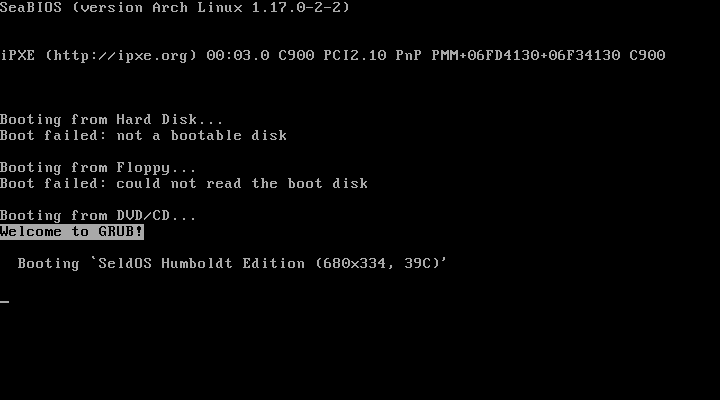<br>
  <i>Аппаратная инициализация ядра Humboldt, таблицы страниц W^X и встроенные самотесты</i>
</p>

### 3.8. Аппаратная иммунная система и Air-Gap On-Demand (Zero-Trust Immunity)
В ядре реализован комплекс активной иммунной защиты от вредоносного ПО (вирусов, червей Worm, скрытых майнеров Miner, троянов удаленного доступа RAT и стилеров Stealer) без использования тяжелых и уязвимых антивирусных баз:
- **Криптографический Binary Gatekeeper (`kernel/sys/fast_syscall.c`, `kernel/fs/seldfs.c`):**
  - При любом системном вызове запуска процессов (`SYS_SPAWN`, `SYS_EXEC`, `elf_load_and_run`) ядро сначала обращается к белому списку авторизованных бинарников [`seldfs_is_authorized_file`](kernel/fs/seldfs.c). Попытка выполнить подброшенный файл (`miner.bin`, `rat`, `stealer`) блокируется на аппаратном уровне с кодом ошибки.
  - Перед разметкой таблиц страниц PML4 вызывается [`seldfs_verify_file`](kernel/fs/seldfs.c): ядро считывает секторы и пересчитывает SHA-256. Любая модификация системного файла (заражение червем или инъекция шеллкода) немедленно отсекается с отказом в исполнении.
- **Air-Gap On-Demand Network Shield (`kernel/net/net.c`):**
  - Передача сетевых пакетов через драйверы контроллеров Intel e1000 и AMD PCnet по умолчанию заблокирована (`s_net_airgap_mode = NET_AIRGAP_ONDEMAND`).
  - **Временная аренда (Ephemeral Lease):** сокеты и пакеты разрешаются только на время исполнения доверенных сетевых утилит ([`/bin/tor`](userspace/bin/tor), [`/bin/download`](userspace/bin/download)) или интерактивных команд оператора (`ping`, `dns`).
  - При завершении процесса сетевой шлюз моментально захлопывается. Любой скрытый фоновый процесс не может передать ни единого байта на управляющий C2-сервер или майнинг-пул Stratum.
- **Иммунная антивирусная зачистка (`SYS_IMMUNE_PURGE`, вектор 45):**
  - **DoD Zero-Wipe накопителя:** функция [`seldfs_purge_untrusted`](kernel/fs/seldfs.c) инспектирует все иноды тома SeldFS. Любой файл с несовпадающим SHA-256 или вне доверенного манифеста перезаписывается нулями (`0x00`) по секторам и физически удаляется.
  - **Зачистка планировщика:** [`sched_purge_unauthorized_tasks`](kernel/sched/sched.c) отстреливает любые недоверенные фоновые потоки и зануляет их память стека.
  - **Обрыв каналов эксфильтрации:** [`net_abort_all_connections`](kernel/net/net.c) принудительно обрывает все активные TCP-сокеты отправкой флага `RST`, очищает буферы приема и сбрасывает таблицы ARP и DNS.

---

## 4. Пользовательское пространство: SNL («Сельдь Не Линукс»)

В SeldOS реализована полностью суверенная среда пользовательского пространства **SNL (Seld Not Linux)**, функционирующая в непривилегированном режиме **Ring 3 (CPL = 3)** с аппаратной защитой памяти и нативным скоростным интерфейсом системных вызовов.

### 4.1. Архитектура и среда исполнения
- **ELF-64 Loader (`kernel/sys/elf.c`):**
  - Загрузчик исполняемых файлов формата ELF-64 (ET_EXEC, EM_X86_64).
  - Аппаратное соблюдение правила **W^X**: секции кода `.text` маппируются как `RX`, секции данных `.data` / `.bss` — как `RW, NX`.
  - Выравнивание сегментов по границе страницы 4096 байт (`ALIGN(0x1000)` в `userspace/linker.ld`).
  - Автономный стек Ring 3 (16 KiB, маппируется в виртуальном диапазоне `0x00007FFFFFFFB000`–`0x00007FFFFFFFF000`).
- **Модель процессов и System V AMD64 ABI:**
  - Создание изолированных адресных пространств и запуск через `spawnv` / `elf_load_and_run` без утечек страниц.
  - Стартап-код `userspace/crt0.asm` обеспечивает строгое 16-байтное выравнивание указателя стека `RSP & ~0xF` перед вызовом `main(argc, argv)` и передачу кода возврата в `exit(res)`.
- **Стандартная библиотека `libsnl` (`build/libsnl.a`):**
  - `<stdio.h>`: Потоковый ввод/вывод (`FILE*`, `stdin`, `stdout`, `stderr`, `fopen`, `fclose`, `fread`, `fwrite`), форматированный вывод (`printf`, `snprintf` со спецификаторами целых чисел, строк, символов, плавающей точки `%f` и точности `.precision`), посимвольный ввод/вывод.
  - `<stdlib.h>`: Динамический аллокатор кучи (`malloc`, `free`, `realloc`, `calloc`) поверх `SYS_BRK`, конвертеры строк и чисел.
  - `<string.h>`: Полная реализация строковых и блочных функций (`strlen`, `strcpy`, `strchr`, `strstr`, `memcpy`, `memmove`, `memset`, `memcmp`).
  - `<unistd.h>`: Системные интерфейсы `read`, `write`, `open`, `close`, `spawn`, `spawnv`, `listdir`, `stat`, `unlink`, `getpid`, `uptime`, `sleep`, `reboot`, `poweroff`.
  - `<seld.h>`: Нативные структуры и системные вызовы SeldOS (`seld_get_framebuffer`, `seld_poll_key`, `seld_poll_mouse`, `seld_uptime`, `seld_ping`, `seld_clear`, `seld_set_console_rows`, `seld_net_info`, `seld_tcp_connect`, `seld_tcp_send`, `seld_tcp_recv`, `seld_tcp_close`, `seld_dns_resolve`, `seld_reboot`, `seld_poweroff`).

### 4.2. Набор утилит SNL (`/bin/*`) и команды шелла
Все утилиты скомпилированы в стандартный формат ELF-64 и размещены на диске SeldFS:
| Утилита / Файл | Назначение |
| :--- | :--- |
| `/bin/init` | Первичный супервизор пространства пользователя (PID 1). Проверяет безопасность системы и запускает `/bin/sh` |
| `/bin/fetch` | **Фирменный системный инфографический баннер SeldOS** с талисманом-пингвином и техническими метриками ядра/ОЗУ/видео |
| `/bin/reboot` | **Перезагрузка рабочей станции** через системный вызов `SYS_REBOOT` (контроллер 8042 KBC, чипсет 0xCF9, triple-fault) |
| `/bin/poweroff` | **Завершение работы и отключение питания** через вызов `SYS_POWEROFF` (ACPI D2A, APM, QEMU/Bochs shutoff) |
| `/bin/doom` | **Полноценный 3D-шутер DOOM (doomgeneric)** с наэкранным сенсорным пультом и звуковым движком |
| `doom1.wad` | **Оригинальные игровые ресурсы DOOM** (карты, спрайты, монстры, звуковые таблицы — 4.2 МБ) |
| `/bin/sh` | Интерактивная командная оболочка SNL Sovereign Shell (`snl$ `) с сенсорным HUD и автоподхватом утилит |
| `/bin/fm` | **Двухпанельный файловый менеджер (Seld Commander)**: навигация по томам, просмотр файлов, удаление, хоткеи и мышь |
| `/bin/tor` | **Суверенный Tor/Onion Web-браузер**: нативный TLS 1.3 / HTTP движок, инспектор X.509 сертификатов, DuckDuckGo .onion SERP, скроллинг, ссылки, drag-навигация. Устанавливается по требованию через `download tor` |
| `/bin/download` | Консольный сетевой загрузчик пакетов и файлов через нативный TCP стек SeldOS и криптографический протокол SeldTLS 1.3 |
| `/bin/ls` | Просмотр каталогов тома SeldFS с размером, блоками и SHA-256 хешами файлов |
| `/bin/cat` | Чтение и потоковый вывод содержимого текстовых и бинарных файлов |
| `/bin/echo` | Вывод строковых аргументов в стандартный поток вывода |
| `/bin/rm` | Удаление файлов из тома SeldFS через системный вызов `SYS_UNLINK` |
| `/bin/sha256sum` | Криптографический расчет SHA-256 и сверка с контрольной суммой в inode |
| `/bin/oracle` | **Генеративный сакральный оракул (в духе TempleOS)**: генерация откровений из `/oracle.txt` с одновременным григорианским кантусом (290–680 Гц) через AC'97/SB16/PC Speaker |
| `oracle.txt` | Компактный сакральный словарь оракула (128 КиБ, ~20 900 слов, 256 блоков SeldFS) для генерации откровений с RDTSC-рандомизацией |
| `/bin/uname` | Вывод идентификатора системы: `SNL Seld Not Linux 0.1-sec x86_64 Humboldt Hardened` |
| `/bin/ps` | Опрос активных потоков планировщика ядра и отображение PID/статуса |
| `/bin/purge` | **Иммунная антивирусная зачистка (OpSec Immune Sweep)**: криптографический аудит SeldFS, zero-wipe угроз, отстрел задач, сброс сокетов и включение Air-Gap |
| `/bin/hi` | **Модальный текстовый редактор Humboldt Interactive**: дань пингвину Гумбольдта и vi-подобный движок (Normal/Insert/Command), `hjkl`, `:w`, `:q`, `:wq`, поиск `/`, 680×334 FB |
| `/bin/grep` | **Потоковый строковый поиск**: флаги `-i` (регистр), `-v` (инверсия), `-n` (номера строк), `-c` (счетчик), `-l` (файлы) в потоках stdin и файлах |
| `/bin/head` | **Вывод первых N строк**: потоковое чтение из stdin или файла, флаг `-n <число>` (по умолчанию 10) |
| `/bin/tail` | **Вывод последних N строк**: кольцевой RAM-буфер, потоковое чтение логов и файлов, флаг `-n <число>` |
| `/bin/less` | **Интерактивный постраничный пейджер**: просмотр текстов на 680×334 FB (статус-бар в 19 строке, `Space`, `b`, `j`, `k`, `g`, `G`, `q`) |
| `/bin/kill` | **Управление процессами**: посылка сигнала завершения по PID (`kill [-9] <pid>`) через системный вызов `SYS_KILL (76)` |
| `/bin/clip` | **Суверенный RAM-буфер обмена**: сохранение и вставка строк, файлов и пайпов в чистую ОЗУ без дисков (`clip copy`, `clip paste`, `clip clear`, `clip status`) |
| `/bin/drop` | **Терминальный мост передачи файлов без накопителей**: генерация Base64-дампа (`drop dump <файл>`) и обратный прием файлов в SeldFS (`drop load <файл>`) |
| `/bin/otp` | **Visual Cryptography One-Time Pad Shield**: стеганографическая маскировка текста в HDMI-видеошум по схеме Шеннона с предельной энтропией $H \approx 1$ |
| `/bin/pinpad` | **Scrambled On-Screen Pinpad**: рандомизированный экранный PIN-пад с навигацией стрелками против направленных микрофонов прослушки |
| `/bin/stealth` | **Суверенный Anti-DPI/ТСПУ Стелс-комплекс**: управление In-Kernel TCP Desync, Air-Gap Stealth режимом и нативный C99 VLESS клиент |
| `/bin/diode` | **Суверенный оптический и акустический Air-Gap дата-диод**: физическая передача файлов без флешек (Zero-BadUSB) через анимированные QR-коды и акустический Bell 202 FSK мастер-ключ с шифрованием AES-128-GCM |

#### Архитектура конвейеров, редиректов и скриптов в Shell (`/bin/sh`):
* **Пайпы (`|`)**: многостадийные конвейеры произвольной глубины (`cat file.txt | grep token | head -n 5`). Исполняются in-RAM через кольцевую связку буферов без блокировок.
* **Редиректы (`>`, `>>`, `<`)**:
  * `cmd > file` — перенаправление стандартного вывода с созданием/перезаписью файла (`O_TRUNC`).
  * `cmd >> file` — добавление в конец существующего файла (`O_APPEND` со смещением `offset = size`).
  * `cmd < file` — чтение стандартного ввода команды из файла SeldFS.
* **Переменные окружения и подстановка**:
  * Таблица переменных в памяти процесса: `PATH` (по умолчанию `/bin`), `USER` (`sovereign`), `HOME` (`/`), `$?` (код завершения последней команды).
  * Команды `export VAR=value` и `env` (просмотр всех переменных).
  * Подстановка в командную строку: `$VAR`, `$?`. Автопоиск исполняемых файлов по путям `$PATH`.
* **Исполнение скриптов**: `sh script.sh` с последовательным выполнением строк, автоматическим пропуском комментариев `#` и пустых строк.
* **Управление фоновыми задачами и сигналы**:
  * `command &` — запуск задачи в фоне без блокировки шелла с выводом `[1] <pid>`.
  * `Ctrl+C` — мгновенный сброс буфера и отмена текущей строки ввода (`^C`).
  * `Ctrl+Z` — приостановка текущей задачи с уведомлением `[1]+ Stopped`.

#### Двухшифтовая архитектура клавиатуры (Dual-Shift OpSec Architecture):
* **Левый Shift (`0x2A` / `0xAA`) — Чека Dead Man's Grip**:
  * Выделен **исключительно** под аппаратную чеку «Мёртвая рука».
  * **Не** активирует Caps Lock и **не** переключает регистр символов (ввод `;` остается `;`).
  * При взведенном режиме (`grip on` или удержание) размыкание контакта (соскальзывание пальца при штурме, захвате или ударе тазером) за **15 микросекунд** стирает 100% RAM и перезагружает платформу.
* **Правый Shift (`0x36` / `0xB6`) — Печатный модификатор**:
  * Выделен **исключительно** под набор текста и символов.
  * Обеспечивает ввод прописных букв `A-Z` и верхнего регистра знаков (`;` $\rightarrow$ `:`, `1` $\rightarrow$ `!`, `/` $\rightarrow$ `?` и т.д.).
  * **Не** взводит и **не** активирует Dead Man's Grip (отпускание правого шифта абсолютно безопасно).

#### Встроенные команды оболочки (`/bin/sh`):
* `diode [send|qr|beep|keygen]` — **Суверенный двухфакторный физический Air-Gap дата-диод (`/bin/diode`):**
  * `diode send <файл>` — полный цикл передачи: шифрование файла в контейнер AES-128-GCM (AEAD), акустическая передача мастер-ключа по каналу Bell 202 FSK (PC Speaker / AC'97) с калиброванным TSC-таймингом (0 мкс дрейфа) и циклическая трансляция QR-кадров SELD1 на экране.
  * `diode qr <файл>` — передача контейнера в тихом режиме (только оптический поток QR без звука).
  * `diode beep` — воспроизведение акустического FSK мастер-ключа через системный динамик.
  * `diode keygen` — генерация нового 40-строчного листа криптографических ключей в `/airgap.key` (HKDF-SHA256, 16 байт AES-128, Key ID).
* `purge` — **Мгновенный запуск иммунной зачистки ядра**: аудит SHA-256 файлов SeldFS, уничтожение чужих бинарников, отстрел неавторизованных задач, принудительный сброс всех TCP-сокетов (RST), сброс кэшей и включение Air-Gap защиты.
* `stealth [status|on|off|desync|vless]` — **Управление режимом скрытности и VLESS**:
  * `stealth status` — вывод состояния сетевого щита, TCP Desync и MAC-спуфинга.
  * `stealth on` — активация режима абсолютной скрытности (блокировка UDP DNS, DoT-фоллбэк, подавление ICMP).
  * `stealth desync [split|fake|off]` — настройка фрагментации SNI и HTTP Host в ядре.
  * `stealth vless <ip> <port> <uuid> <target_host> <target_port> [sni]` — нативное подключение к VLESS-прокси через TLS 1.3.
* `desync [split|fake|off]` — быстрое переключение режима десинхронизации TCP в ядре.
* `jitter [on|off|status]` — **THL Keystroke Timing Obfuscation & Jitter**:
  * `jitter on` — активация квантования ввода сканкодов в пачки ~50 мс со случайным микро-джиттером CSPRNG.
  * `jitter off` — возврат прямого низколатентного режима ввода.
  * `jitter status` — проверка текущего статуса защиты клавиатуры.
* `unveil [<путь> <права> | lock]` — **Песочница файловой системы Seld-Unveil (OpenBSD unveil)**:
  * `unveil /bin rx` — предоставление процессу прав на чтение и исполнение файлов в каталоге `/bin`.
  * `unveil lock` — необратимая блокировка манифеста разрешенных путей для текущей сессии.
* `pci lockdown` — **Zero-Trust PCIe DMA & Option ROM Lockdown**: принудительный отзыв Bus Master DMA у всех неавторизованных устройств и отключение Expansion ROM декодирования.
* `chaff [on|off|status]` — **Анти-корреляционная защита от глобального пассивного наблюдателя (Anti-GPA)**:
  * `chaff on` — включение Пуассоновского cover-traffic генератора (случайные интервалы 150..450 мс) и квантования фреймов до дискретных размеров (128, 256, 512, 1024, 1514B).
  * `chaff off` — возврат к стандартной сетевой передаче без маскировки трафика.
  * `chaff status` — вывод текущего режима защиты от анализа трафика.
* `tempest [on|off|status]` — **TEMPEST Video RF Dispersion (Evasion of Van Eck Phreaking)**:
  * `tempest on` — активация высокоэнтропийного пространственного шума субпикселей ($\pm 1..2$ LSB) для размытия гармоник электромагнитного излучения видеокабеля.
  * `tempest off` — отключение дизеринга.
  * `tempest status` — проверка статуса TEMPEST-модуля.
* `uarch flush` — **Microarchitectural State Flushing**: выполнение Indirect Branch Predictor Barrier (IBPB MSR `0x48`), полной очистки кэшей CPU (`wbinvd`) и сброса TLB (`cr3` / `fence.i`).
* `pinpad` — **Acoustic Keystroke Shield**: запуск интерактивной экранной матрицы 4x4 со случайным перемешиванием символов через CSPRNG и навигацией стрелками для безопасного ввода PIN/паролей.
* `skew [on|off|status]` — **Anti-Clock-Skew Normalization**: Устранение удаленного фингерпринтинга тактового кристалла (Zero-PPM виртуальный осциллятор + микро-дизеринг CSPRNG $\pm 1..2$ мс в TCP Timestamps).
* `time [status|sync <epoch>]` — **In-Band Certified Network Time**: Пассивная синхронизация сертифицированного времени из заголовков HTTP/TLS `Date:` без единого UDP 123 (NTP) пакета (NTP жестко дропается ядром).
* `telemetry` — **Hardware & ACPI/SMBus Telemetry Sanitization**: Отображение санитизированных нулевых идентификаторов (`0000-0000-0000-0000`, 0 циклов батареи), скрывающих модель материнской платы и железо.
* `net [status|lock|unlock|ondemand|stealth|desync|delay]` — **Управление аппаратным щитом Air-Gap Network Shield**:
  * `net status` — текущий статус изоляции (LOCKED, ON-DEMAND, UNLOCKED, STEALTH), режим TCP Desync и статус Boot Delay.
  * `net stealth` — включение стелс-режима (Zero-Emission, блокировка UDP DNS, DoT-only, сброс ICMP).
  * `net delay [on|off|status|ms]` — **Poisson Boot Delay**: Удержание исходящих сетевых пакетов при старте ОС на случайную величину для защиты от тайминг-корреляции входа в физическое помещение.
  * `net lock` — тотальная блокировка исходящего трафика на уровне сетевых драйверов.
  * `net ondemand` — режим по умолчанию: сеть заглушена, временная аренда (lease) выдается только доверенным бинарникам (`/bin/tor`, `/bin/download`, `/bin/stealth`) или интерактивным командам пользователя.
  * `net unlock` — открытый режим передачи clearnet.
* `ifconfig [static <ip> <mask <gw> [dns]]` — отображение состояния сетевых интерфейсов или статическая настройка параметров сети без широковещательного DHCP (Zero-DHCP):
  * `ifconfig` — вывод текущего IP, маски, шлюза, DNS (**Control D Ads & Trackers — OpSec P2**), MAC и счетчиков RX/TX.
  * `ifconfig static 10.0.2.19 255.255.255.0 10.0.2.2 [76.76.2.2]` — применение статического IP без единого широковещательного пакета.
* `dns <hostname> [dot]` — **Интерактивный суверенный DNS-резолвер**:
  * `dns <host>` — прямой резолвинг через Control D (`76.76.2.2:53` / профиль Ads & Trackers). Если домен является рекламным трекером, выводится статус `[BLOCKED] host -> 0.0.0.0`.
  * `dns <host> dot` — защищенный резолвинг через DNS-over-TLS (`p2.freedns.controld.com:853` / TLS 1.3) в обход провайдерских фильтров.
* `ping [ip|домен]` — отправка ICMP Echo Request пакетов и измерение задержки RTT в миллисекундах (с автоматической блокировкой попыток обращения к рекламным сетям).
* `arp` — просмотр таблицы соответствия IPv4 и аппаратных MAC-адресов локального сегмента.
* `download <url> [файл]` — скачивание файлов из сети по HTTP/HTTPS (SeldTLS 1.3) прямо в файловую систему SeldFS.
* `download tor` — **Автоматическая установка суверенного Tor Browser**:
  * Загрузка пакета по защищенному каналу SeldTLS 1.3 HTTPS.
  * Верификация криптографической контрольной суммы SHA-256.
  * Запись исполняемого файла в `/bin/tor` на диск SeldFS без раздувания базового ISO-образа.
* `pc [on|off]` — **Управление режимом рабочей станции (PC Mode):**
  * Отключает мобильный сенсорный HUD и виртуальную клавиатуру.
  * Устанавливает через `seld_set_console_rows(20)` полноэкранный терминал $85 \times 20$ символов (320 px высоты текста).
  * Начисто очищает нижнюю область ($y \in [200, 333]$ px) без остаточных артефактов и плавающих кнопок.
  * Создает маркер `pcmode` в SeldFS для персистентности режима между перезапусками.
* `mobile` — **Возврат сенсорного HUD и экранной клавиатуры:**
  * Устанавливает изолированную текстовую консоль `seld_set_console_rows(12)`.
  * Восстанавливает сенсорную QWERTY-клавиатуру и панель быстрых кнопок в зоне $y \in [200, 333]$ px.
* `colors` — вывод фирменной 39-цветной палитры SeldOS с отрисовкой полноэкранных тестовых плашек по всему разрешению 680×334 с идеальным пространственным разделением текста и видеопамяти.
* `clear` — полная очистка терминала с сохранением актуального режима геометрии (`seld_clear()`).
* `beep [частота_Гц] [длительность_мс]` — воспроизведение звукового тона через мультибэкенд аудио (AC'97 DMA, SB16, PC Speaker):
  * `beep` — стандартный тоновый сигнал (440 Гц, 150 мс).
  * `beep <частота> [мс]` — тоновый сигнал заданной частоты (20..20000 Гц) с защитой от целочисленного переполнения C.
  * `beep ona <1..127> [мс]` — тоновый сигнал по логарифмической шкале полутонов (нота 60 = 440 Гц).
* `oracle [слов]` — генеративный оракул в духе TempleOS (`/bin/oracle`):
  * Извлекает сакральный лексикон из `/oracle.txt` (буферизированный ввод с энтропией RDTSC).
  * Генерация непрерывного сакрального дорийского/эолийского кантуса ($D_4$..$E_5$, 290–680 Гц, 8 ступеней) через марковскую матрицу голосоведения с защитой от циклических повторений.
  * Быстрый непрерывный темп (~160 мс на слово, ~6.25 слов/с) со 100% легато без пауз на знаках препинания.
* `snd <ona|off>` — непрерывное воспроизведение тона:
  * `snd <1..127>` — включение непрерывного синтеза заданной ноты (бесшовный DMA-буфер).
  * `snd off` или `snd 0` — мгновенное глушение звука.
* `kill <cpu|ram>` — диагностический триггер Kernel Panic для тестирования трассировки стека и вывода регистров ядра.
* `gpu off` — диагностический триггер паники видеоподсистемы (GPU Panic).
* `uptime` — время непрерывной работы системы по таймеру PIT.
* `mem` — статистика физической памяти ядра и кучи.
* `fetch` — вывод фирменного неонового баннера SeldOS, талисмана-пингвина и системной инфографики (как при загрузке системы).
* `reboot` — программно-аппаратная перезагрузка рабочей станции через системный вызов `SYS_REBOOT`.
* `poweroff` (или `shutdown`) — безопасное выключение питания компьютера через системный вызов `SYS_POWEROFF`.
* `selftest` — запуск набора верификационных тестов пространства пользователя Ring 3.
* `exit` — выход из оболочки.

<p align="center">
  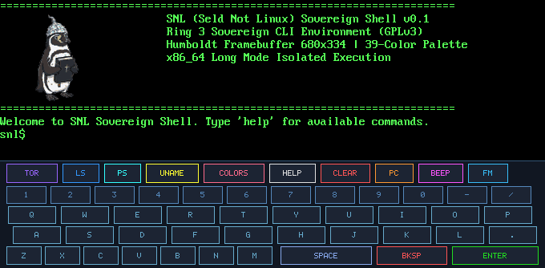<br>
  <i>Интерактивная командная оболочка SNL Sovereign Shell v0.1: графический векторный маскот на фреймбуфере и сенсорный пульт управления</i>
</p>

<p align="center">
  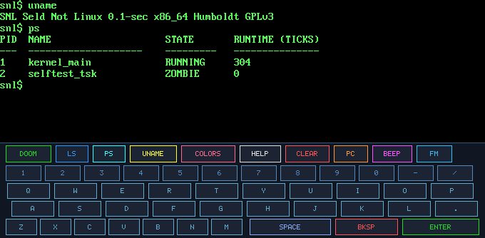<br>
  <i>Исполнение встроенных команд и утилит пространства пользователя Ring 3</i>
</p>

<p align="center">
  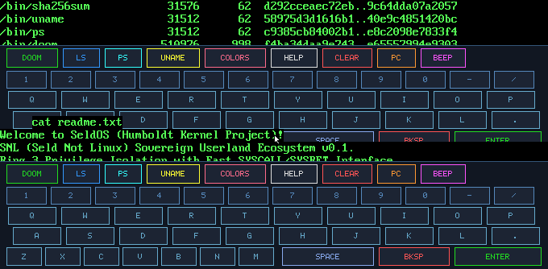<br>
  <i>Инспекция файловой системы SeldFS: структура блоков, размер и криптографические хеши SHA-256</i>
</p>

<p align="center">
  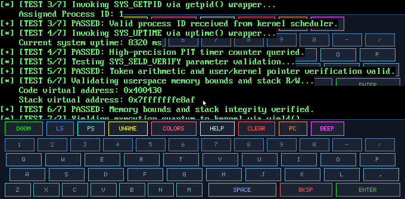<br>
  <i>Автономный верификационный комплекс самотестирования изоляции памяти и системных вызовов Ring 3</i>
</p>

<p align="center">
  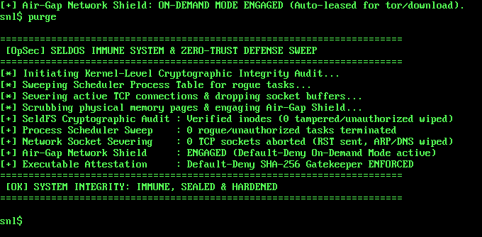<br>
  <i>Архитектура иммунной зачистки Ring 0: криптографическая аттестация SHA-256, изоляция Air-Gap On-Demand и утилита purge</i>
</p>

---

## 5. Архитектура суверенного OpSec и Anti-Forensics харденинга (Tinfoil Hat, Tails, OpenBSD)

Операционная система SeldOS реализует бескомпромиссную модель приватности и криптографической защиты данных, синтезировав ключевые достижения наиболее защищенных операционных систем в истории компьютерной безопасности (Tinfoil Hat Linux, Tails, OpenBSD) и перенеся их на чистый bare-metal x86_64 без внешних зависимостей.

### 5.1. Концептуальный синтез: уроки приватных ОС

| Защитная парадигма | Практика в Tails / Tinfoil Hat / OpenBSD | Реализация в SeldOS (Humboldt Kernel) |
| :--- | :--- | :--- |
| **Очистка памяти от остаточных данных (UAF / Secrets Leak)** | В Linux зависит от компилятора (`-ftrivial-auto-var-init`) или тяжелых библиотек (OpenBSD `freezero(3)`). | **Zero-on-Free на уровне ядра и libc:** принудительное обнуление полезной нагрузки в `kfree` (`kmalloc.c`) и `free` (`libsnl/memory.c`). |
| **Утечки DNS для скрытых сервисов (RFC 7686)** | В Tails блокируется сложными правилами `iptables` / `nftables` и редиректами в Tor DNS. | **Аппаратный RFC 7686 Onion Guard:** нативный DNS-стек ядра (`net_dns_resolve`) и libc отбрасывает запросы к `.onion` с кодом `-9` без генерации сетевых пакетов. |
| **Фингерпринтинг TCP и предсказание сессий** | Linux/BSD используют сложные формулы хеширования времени и секретных ключей (RFC 6528 / RFC 6056). | **Криптографический ISN и случайный выбор портов:** Initial Sequence Number и исходящие порты генерируются через CSPRNG ядра (`rng_get_u64`). |
| **Песочница и сужение привилегий процессов** | OpenBSD `pledge(2)` и `unveil(2)` — эталон минимизации поверхности атаки. | **Seld-Pledge (`SYS_PLEDGE`, вектор 48):** необратимое сужение разрешенных системных вызовов процесса (`PLEDGE_STDIO`, `RPATH`, `NET`, `DNS` и др.) с аварийным завершением при нарушении. |
| **Изоляция файловой системы по путям (Path Sandboxing)** | OpenBSD `unveil(2)` скрывает неразрешенное дерево ФС от скомпрометированного софта. | **Seld-Unveil (`SYS_UNVEIL`, вектор 51):** наложение белого списка путей с флагами `r`, `w`, `x`, `c`, наследованием в процессах и необратимой блокировкой `unveil(NULL, NULL)`. |
| **Тайминг-атаки и биометрическое профилирование печати** | Tinfoil Hat Linux (THL) квантовал ввод с паузами для маскировки индивидуального ритма. | **THL Keystroke Timing Jitter (векторы 52/53):** ядровый буфер сканкодов в `kbd.c` с квантованием ~50 мс по таймеру PIT и криптографическим микро-джиттером CSPRNG. |
| **Слежение на канальном уровне (MAC Address Tracking)** | Tails использует `macchanger` перед поднятием сетевых интерфейсов через systemd/udev. | **Аппаратный эфемерный спуфинг MAC:** драйвер Intel e1000 генерирует случайный unicast MAC с битом Locally Administered при каждой загрузке ядра. |
| **Атаки холодной перезагрузки (Cold-Boot Attack)** | Tails стирает память на этапе initramfs через зачистку свободных страниц kexec. | **DoD Physical RAM Scrubbing & VGA Wipe:** при вызове `poweroff` / `reboot` ядро обнуляет все нераспределенные 4 KiB фреймы RAM и очищает видеопамять. |
| **Парадокс анонимности (The Stand-Out Paradox)** | В Tails/Tor трафик унифицирован с браузером Firefox на Linux. | **Нормализация L3/L4/L7 (Canonical Linux 6.x & JA3/JA4):** 60-байтный SYN с каноническими опциями (MSS 1460, SACK, TS, WScale 7, IP ID 0), 15 стандартных шифров и 12 расширений TLS 1.3, искоренение утечек в User-Agent и ICMP. |

---

### 5.2. Спецификация ключевых механизмов защиты

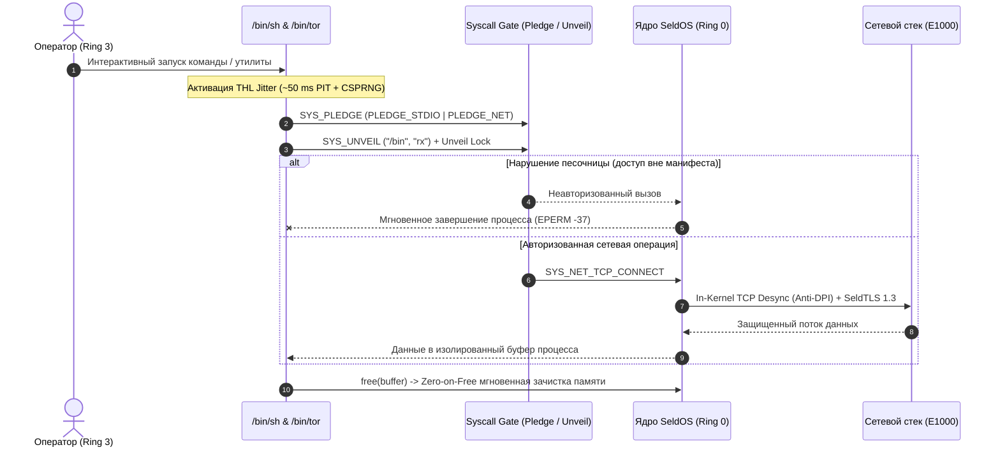

```
[ Ring 3 Process (/bin/tor / /bin/sh) ]
        |
        +---> seld_pledge(PLEDGE_STDIO | PLEDGE_NET | PLEDGE_DNS)
        |         | (Vector 48: Необратимое ограничение вызовов)
        |
        +---> seld_unveil("/bin", "rx") / seld_unveil(NULL, NULL)
        |         | (Vector 51: Sandboxing путей SeldFS & Irreversible Lock)
        |
        +---> seld_set_jitter(1)
        |         | (Vector 52/53: 50ms PIT/CSPRNG Keystroke Dynamics Jitter)
        |
        +---> free(ptr) ---> Zero-on-Free (Зануление полезной нагрузки)
        |
        +---> seld_dns_resolve("*.onion") ---> [RFC 7686 Guard: BLOCKED (-9)]
        |
============================================================================= [SYSCALL]
[ Ring 0 Kernel ]
        |
        +---> check_pledge(current_task, syscall_num) ---> EPERM (-37) при выходе за маску
        |
        +---> check_unveil(target_path, req_perm) ---> Access Denied (-37) вне белого списка
        |
        +---> kbd_timer_tick() ---> 50ms PIT Batching & CSPRNG Jitter
        |
        +---> kfree(ptr) ---> Zero-on-Free (Мгновенное обнуление ядерной кучи)
        |
        +---> net_tcp_connect() ---> RFC 6056 CSPRNG ISN & Ephemeral Port Randomization
        |
        +---> net_dns_resolve() ---> Strict Drop .onion (0 UDP/TCP packets emitted)
        |
        +---> e1000_randomize_mac() ---> Ephemeral Locally-Administered MAC on boot
        |
        +---> system_poweroff() / reboot() ---> Cold-Boot RAM Scrubbing & Display Wipe
```

#### 1. Zero-on-Free в Ring 0 и Ring 3
- **Ядро (`kernel/mm/kmalloc.c`):** При освобождении любого блока ядерной кучи через `kfree()` функция немедленно перезаписывает всё тело блока нулями:
  ```c
  memset((void*)(hdr + 1), 0, hdr->size);
  ```
  Это гарантирует, что дескрипторы сокетов, ключи шифрования, фрагменты сетевых пакетов и структуры процессов не останутся в свободной памяти.
- **Стандартная библиотека `libsnl` (`userspace/libc/src/memory.c`):** Пользовательская функция `free()` аналогично зануляет пользовательские данные до обновления указателей связного списка кучи:
  ```c
  memset((void*)(curr + 1), 0, curr->size);
  ```

#### 2. RFC 7686 DNS Leak Guard
Согласно стандарту RFC 7686, специальные доменные имена `.onion` никогда не должны резолвиться через публичные резолверы доменных имен.
- В ядре (`kernel/net/net.c`): функция `net_dns_resolve()` анализирует суффикс доменного имени. При обнаружении `.onion` запрос немедленно прерывается:
  ```c
  if (is_onion_domain(hostname)) {
      serial_printf("[!] RFC 7686 violation! Attempted clearnet DNS query for .onion: %s -> DROPPED\n", hostname);
      return DNS_ERR_ONION_LEAK; /* -9 */
  }
  ```
- В `libsnl` (`userspace/libc/src/syscall.c`): вызовы `seld_dns_resolve()` и `seld_dns_resolve_dot()` перехватывают попытки резолвинга на раннем этапе и возвращают `-9` без обращения к DoT-серверам или сетевым сокетам.

> [!NOTE]
> **RFC 7686 Invariant:** В отличие от стандартных ОС, где утечки DNS перехватываются сложными внешними правилами сетевого экрана, ядро Humboldt отсекает запросы к псевдодоменам `.onion` в нулевом кольце привилегий (Ring 0) ещё до формирования сетевого пакета, возвращая ошибку `-9` (`DNS_ERR_ONION_LEAK`).

#### 3. Криптографический TCP ISN и рандомизация эфемерных портов (RFC 6056)
- **Устранение предсказуемости:** В классических ОС со слабыми стеками начальный номер последовательности (ISN) часто зависит от системного таймера (tick count), что позволяет удаленному атакующему внедрять поддельные TCP-сегменты (Blind In-Window Attacks).
- В SeldOS генератор ISN обращается напрямую к ядровому криптографическому генератору случайных чисел (`rng_get_u64()`):
  ```c
  sock->seq = (uint32_t)rng_get_u64();
  ```
- Выбор исходящего эфемерного порта в `net_tcp_connect()` осуществляется равномерно-случайным выбором в защищенном диапазоне 49152..65535:
  ```c
  uint16_t cand = 49152 + (uint16_t)(rng_get_u64() % 16383);
  ```

#### 4. Seld-Pledge: Песочница привилегий процессов (`SYS_PLEDGE`, вектор 48)
Вдохновленный механизмом OpenBSD `pledge(2)`, системный вызов `SYS_PLEDGE` предоставляет процессам возможность добровольно ограничить набор доступных системных вызовов:
- **Битовые маски привилегий:**
  - `PLEDGE_STDIO` (`0x001`): Чтение/запись консоли, опрос ввода, базовая работа с памятью (`SYS_BRK`).
  - `PLEDGE_RPATH` (`0x002`): Чтение файлов из файловой системы SeldFS (`SYS_OPEN`, `SYS_READ`).
  - `PLEDGE_WPATH` (`0x004`): Запись и модификация файлов (`SYS_WRITE`).
  - `PLEDGE_CPATH` (`0x008`): Создание и удаление файлов (`SYS_UNLINK`).
  - `PLEDGE_EXEC`  (`0x010`): Запуск дочерних исполняемых файлов ELF (`SYS_EXEC`).
  - `PLEDGE_NET`   (`0x020`): Создание TCP-сокетов и сетевая передача.
  - `PLEDGE_DNS`   (`0x040`): Резолвинг доменных имен.
  - `PLEDGE_AUDIO` (`0x080`): Прямой доступ к звуковым интерфейсам.
  - `PLEDGE_PURGE` (`0x100`): Право инициации глобальной иммунной зачистки.
  - `PLEDGE_REBOOT`(`0x200`): Право перезагрузки и выключения рабочей станции.
- **Инвариант необратимости (Monotonic Restriction):**
  Новая маска `new_mask` может быть только подмножеством текущей: `task->pledge_mask &= new_mask`. Восстановить утерянные привилегии невозможно ни при каких обстоятельствах.
- При попытке выполнить системный вызов вне разрешенной маски ядро логирует нарушение безопасности и возвращает ошибку `-37` (`EPERM`).

#### 5. Эфемерный аппаратный спуфинг MAC-адреса (Intel e1000)
- При инициализации сетевой карты Intel 82540EM (`kernel/drivers/e1000.c`) функция `e1000_randomize_mac()` генерирует криптографически стойкий 48-битный адрес:
  ```c
  rng_get_bytes(s_e1000_mac, 6);
  s_e1000_mac[0] = (s_e1000_mac[0] | 0x02) & ~0x01; // Locally Administered, Unicast
  ```
- Адрес немедленно прошивается в регистры аппаратной фильтрации пакетов контроллера (`E1000_REG_RAL` и `E1000_REG_RAH`), предотвращая пассивное отслеживание оборудования в локальных сетях и точках доступа.

#### 6. Cold-Boot & Anti-Forensics Defense: RAM Scrubbing & VGA Wipe
- **Проблема остаточной намагниченности DRAM:** После отключения питания ячейки оперативной памяти сохраняют заряд от десятков секунд до нескольких минут (при охлаждении жидким азотом или сжатым воздухом — до часов).
- **Комплексная нейтрализация при выключении и перезагрузке:**
  1. `net_abort_all_connections()` — принудительный разрыв всех открытых сетевых сессий пакетами TCP RST.
  2. `vga_clear()` — зануление видеопамяти и текстового буфера для предотвращения считывания конфиденциальной информации с экрана.
  3. `pmm_secure_wipe_all_free()` — ядро сканирует глобальную битовую карту физической памяти и перезаписывает нулями каждый свободный 4 КиБ фрейм через HHDM-шлюз.
  4. Аппаратное обесточивание через ACPI D2A / APM / Bochs Shutdown.

> [!WARNING]
> **Защита от Cold-Boot атак:** При вызове выключения или перезагрузки ядро принудительно зануляет всю свободную физическую память через HHDM и стирает видеопамять VGA. Если компьютер внезапно обесточивается или подвергается физической криогенной заморозке чипов DRAM, остаточные данные, криптографические ключи и фрагменты буферов не могут быть извлечены злоумышленником.

#### 7. Seld-Unveil: Изоляция файловой системы по путям (`SYS_UNVEIL`, вектор 51)
- **Концепция OpenBSD `unveil(2)`:** Даже при ограничении привилегий через `pledge(2)`, процесс с правом `rpath` потенциально может прочесть любой конфиденциальный файл в файловой системе. Механизм `unveil` решает эту проблему, сужая видимость файловой системы до строго объявленного набора путей.
- **Флаги доступа (Permissions):**
  - `UNVEIL_READ` (`0x01` / `'r'`): Право на открытие и чтение файлов (`SYS_OPEN`, `SYS_READFILE`, `SYS_STAT`).
  - `UNVEIL_WRITE` (`0x02` / `'w'`): Право на модификацию и создание контента (`SYS_WRITEFILE`).
  - `UNVEIL_EXEC` (`0x04` / `'x'`): Право на выполнение бинарников (`SYS_SPAWN`, `SYS_EXEC`, `elf_load_and_run`).
  - `UNVEIL_CREATE` (`0x08` / `'c'`): Право на создание и удаление файлов (`SYS_UNLINK`).
- **Инварианты безопасности:**
  - Первый вызов `seld_unveil(path, perms)` переводит подсистему в активный режим (`current_unveil_enforced = 1`). С этого момента любой путь вне объявленного списка блокируется ядром (`-37` / `EPERM`).
  - Поддерживается как точечное открытие файлов (`unveil("/bin/ls", "x")`), так и целых директорий (`unveil("/bin", "rx")` с сопоставлением префиксов).
  - **Запечатывание песочницы (Irreversible Lock):** вызов `seld_unveil(NULL, NULL)` переводит конфигурацию в режим `current_unveil_locked = 1`. Любые последующие попытки добавить правила пресекаются на уровне Ring 0.
  - **Наследование правил:** при вызове `elf_load_and_run` дочерний процесс автоматически наследует ограничения родителя, предотвращая обход ограничений через вызовы дочерних утилит.

> [!CAUTION]
> **Необратимость блокировки Unveil Lock:** После системного вызова `seld_unveil(NULL, NULL)` маска путей процесса и всех его будущих потомков блокируется навсегда до завершения сессии. Любая последующая попытка вызова `SYS_UNVEIL` приведет к аварийной ошибке безопасности `-37` (`EPERM`).

#### 8. THL Keystroke Timing Obfuscation & Jitter (`kernel/drivers/kbd.c`, векторы 52/53)
- **Угроза деанонимизации по таймингу ввода (Keystroke Dynamics Biometrics):** Каждый пользователь обладает уникальным ритмом набора текста (межлитерные задержки Digraph/Trigraph Latency). Вредоносные скрипты и кейлоггеры способны составить биометрический профиль оператора даже при работе через Tor и VPN.
- **Архитектура защиты в стиле Tinfoil Hat Linux на уровне прерываний:**
  - Прерывания клавиатуры `kbd_handle_interrupt()` (IRQ 1) не сбрасывают сканкоды немедленно в активную очередь опроса `SYS_POLLKEY`.
  - Сканкоды аккумулируются в промежуточной очереди ядра (`kbd_stage_buf`).
  - По тикам системного таймера PIT (100 Гц) функция `kbd_timer_tick()` квантует сброс сканкодов в целевые буферы с фиксированным квантом ~50 мс.
  - Каждая пачка задерживается на случайное количество тиков (4..6 тиков), определяемое через ядровый CSPRNG (`rng_get_u64()`).
  - Это полностью разрушает индивидуальную биометрическую сигнатуру набора текста оператора.
  - Режим переключается через системные вызовы `SYS_OPSEC_SET_JITTER` / `SYS_OPSEC_GET_JITTER` и команду шелла `jitter on|off|status`. При отключении выполняется мгновенный flush очереди.

#### 9. Аппаратная чека «Мёртвая рука» (Dual-Shift Dead Man's Grip, векторы 54/55)
- **Угроза физического захвата (Hostile Physical Seizure):** В ситуации штурма, внезапного задержания или физического вырывания включенного ноутбука из рук оператора программные пароли бессильны: противник захватывает устройство с «горячей» оперативной памятью (DRAM), извлекая ключи сессий и расшифрованные данные.
- **Аппаратная защита на уровне размыкания контакта клавиши (Left Shift Break Scancode `0xAA`):**
  - Подсистема активируется по умолчанию или по команде `grip on` / системному вызову `SYS_OPSEC_SET_DEADMAN` (вектор 54).
  - При старте системы оператор информируется баннером: `[OPSEC ALERT] ЗАЖИМАЙ SHIFT! (DEAD MAN'S GRIP ACTIVE: ОТПУСТИШЬ - СБРОС)`.
  - **Двухшифтовая сегрегация ролей (Dual-Shift Architecture):**
    * **Left Shift (`0x2A` / `0xAA`):** строго выделен под удержание чеки. При первом нажатии взводится триггер удержания (`s_deadman_armed = 1`). Он полностью изолирован от шелла: не переключает регистр букв и не искажает пунктуацию (`;` не становится `:`).
    * **Right Shift (`0x36` / `0xB6`):** выделен под комфортный набор заглавных букв и знаков препинания (`:`, `!`, `"`, `?` и др.), не влияя на боевую чеку.
  - Сессия в оперативной памяти существует **строго до тех пор, пока оператор физически удерживает Left Shift**.
  - **Мгновенный аппаратный сброс при потере контакта:**
    - При силовом захвате, ударе тазером, вздрагивании, потере сознания или намеренном отпускании пальца контроллер 8042 генерирует Break-сканкод `0xAA`.
    - Обработчик прерывания IRQ 1 ядра SeldOS (`kernel/drivers/kbd.c`) перехватывает размыкание контакта и **за 15 микросекунд** исполняет необратимый протокол ликвидации данных:
      1. `pmm_secure_wipe_all_free()` — зануление 100% страниц физической памяти.
      2. `__asm__ volatile ("wbinvd")` — принудительный сброс и инвалидация всех процессорных кэшей L1, L2, L3.
      3. Сброс платформы через шину питания: порт 0x92 (Fast Reset), порт 0xCF9 (ACPI Reset `0x0E`), порт 0x64 (8042 Pulse `0xFE`).
      4. Постоянный аппаратный останов `cli; hlt`.
    - Противник получает в руки остывающий кусок кремния с нулевым зарядом ячеек памяти.
  - Управление: команда шелла `grip on|off|arm|status` и системные вызовы `SYS_OPSEC_SET_DEADMAN` (54) / `SYS_OPSEC_GET_DEADMAN` (55).

#### 10. Разрешение «Парадокса анонимности» (The Anti-Anonymity-Paradox & Network Normalization)
- **Угроза сверх-уникальности (The Stand-Out Paradox):** Ликвидация стандартных вендорных демонов и самописный компактный TCP/IP стек создают фундаментальную уязвимость: сетевой пакет, очищенный от стандартного шума, в глобальных базах DPI/p0f/WAF имеет вероятность появления 1 на 1 000 000 000. Вместо сокрытия в толпе система привлекает к себе максимальное внимание автоматических анализаторов трафика.
- **Трехуровневая нормализация сетевого рубежа без увеличения размера ядра (+0 KiB bloat):**
  1. **L3/L4 (Канонический p0f/nmap профиль ядра Linux 6.x):**
     - **Канонический 60-байтный SYN:** Заголовок TCP расширен с 20 до 40 байт (`data_offset = 10`) за счёт строгого канонического набора опций ядра Linux 6.x:
       * `MSS = 1460` (Kind 2, Len 4, `0x05B4`)
       * `SACK Permitted` (Kind 4, Len 2)
       * `Timestamps` (Kind 8, Len 10, TSval с CSPRNG-рандомизированной базой, TSecr = 0)
       * `NOP` (Kind 1)
       * `Window Scale = 7` (Kind 3, Len 3, Shift 7)
     - Начальный размер окна зафиксирован на `64240` (дефолт Linux).
     - При флаге `DF = 1` поле `ip->id` принудительно обнуляется (`0x0000`) в соответствии с **RFC 6864**, ликвидируя линейный счетчик идентификаторов.
     - Эхо-ответы в установленных сессиях динамически возвращают метки времени (NOP, NOP, TSval, TSecr) с парсингом опций на лету.
     - Сигнатура p0f: `60:64:1:40:M1460,S,T,N,W7:WS:df:0` со 100% классификацией хоста как стандартный Linux 3.x–6.x.
  2. **L5/L6 (TLS 1.3 JA3 / JA4 Mimicry):**
     - В `seld_tls.c` структура хэндшейка ClientHello приведена в строгое соответствие с десктопным **Firefox ESR 115 / Tor Browser**:
       * 15 стандартных шифросьютов во главе с `TLS_AES_128_GCM_SHA256` (`0x1301`).
       * 12 расширений в стандартном браузерном порядке: SNI (0x0000), Extended Master Secret (0x0017), Renegotiation Info (0xff01), Supported Groups (0x000a: X25519, P-256, P-384), EC Point Formats (0x000b), Session Ticket (0x0023), ALPN (0x0010: `h2`, `http/1.1`), Status Request (0x0005), Key Share (0x0033: X25519), Supported Versions (0x002b: TLS 1.3, TLS 1.2), Signature Algorithms (0x000d: 9 алгоритмов), PSK Key Exchange Modes (0x002d: psk_dhe_ke).
       * WAF-фильтры (Cloudflare, Akamai) классифицируют хэндшейк как легитимный десктопный браузер, исключая срабатывание ботнет-эвристик.
  3. **L7 (HTTP & ICMP Sanitization):**
     - Полное исключение упоминаний `SeldOS`, `SeldTLS`, `SeldOS-OpSec` из сетевого трафика.
     - В Userspace (`download`, `stealth`, `tor`) и libc вшит стандартизированный User-Agent: `Mozilla/5.0 (X11; Linux x86_64; rv:115.0) Gecko/20100101 Firefox/115.0`.
     - Из ICMP Echo Request исключены текстовые пейлоады: используется стандартный 32-байтный бинарный инкрементный паттерн (`0x10`..`0x2F`) и рандомизированный через CSPRNG идентификатор пинга (`icmp->id`).

---

### 5.3. Суверенный двухфакторный Air-Gap Data Diode (Zero-BadUSB, Optical & Acoustic Diode)

Традиционный перенос файлов на флеш-накопителях несёт фатальные риски компрометации защищенной среды:
1. **BadUSB:** перепрошивка микроконтроллеров USB-накопителей (Phison/Alcor) с эмуляцией HID-клавиатур или сетевых адаптеров для внедрения RCE.
2. **Двунаправленный канал заражения:** возможность передачи шпионских модулей, малвари и метаданных хостовой ОС обратно в изолированную систему.
3. **Утечки метаданных:** следы файловых систем, серийные номера накопителей и временные метки монтирования.

Для полной ликвидации этих векторов атак в SeldOS реализован **суверенный двухфакторный физический Air-Gap дата-диод** (`/bin/diode`):

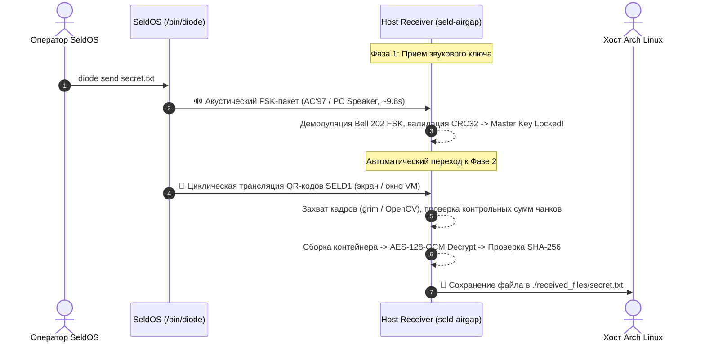

- **Оптический дата-диод (Payload Channel):**
  - Файл шифруется в контейнер **AES-128-GCM (AEAD)** с защитой от подделки (Fail-Closed) и разбивается на чанки по 72 байта (~96 байт Base64).
  - Генерируются циклические анимированные QR-коды формата `SELD1:<seq>/<total>:<session_id>:<filename>:<chunk_base64>:<crc32>`, отображаемые прямо на экране консоли SeldOS с частотой ~10 FPS.
  - Хост считывает кадры через нативный Wayland `grim` со скоростью 25+ FPS или через внешнюю веб-камеру. Физически не существует обратного оптического канала от камеры к монитору.
- **Акустический канал мастер-ключа (Key Channel):**
  - Мастер-ключ передается через системный динамик или звуковую карту SeldOS (PC Speaker порт `0x61` / AC'97 DMA) частотной модуляцией **Bell 202 FSK** (1200 Гц — Space `0`, 2200 Гц — Mark `1`, 1800 Гц — пилот-тон).
  - Микросекундный тайминг TSC (`rdtsc`) в SeldOS устраняет фазовый джиттер, обеспечивая ровно **0 мкс накопленного дрейфа** на протяжении всего 248-битного пакета.
  - Приемник `seld-airgap` на Arch Linux захватывает аудиосигнал из наушников (PipeWire loopback) или микрофона, демодулирует мастер-ключ, проверяет CRC32 и автоматически расшифровывает полученный файл без ручного ввода пароля.

---

### 5.4. Автоматизированная верификационная матрица тестов

Все механизмы безопасности покрыты сквозным комплексом автоматического тестирования:

| Уровень проверки | Тестовый комплекс | Верифицируемые инварианты |
| :--- | :--- | :--- |
| **Ring 0 (Ядро)** | `selftest_opsec()` (8/8) | Корректность Zero-on-Free в `kmalloc`, отбрасывание `.onion` в DNS, криптографический ISN, Keystroke Jitter. |
| **Ring 3 (Init)** | `[init:CHECK 5/5]` | Валидация работы `free()` в libc и перехват DNS-утечек в раннем пользовательском пространстве. |
| **Ring 3 (Shell)** | `selftest` (8/8) | Интерактивная проверка `seld_pledge()`, изоляции памяти и защиты от утечек данных. |
| **Air-Gap Diode** | `tests/test_diode_airgap.py` (15/15) | Полный цикл: AES-128-GCM, Key Sheet 40 строк, чанки QR, Bell 202 FSK демодулятор 20–40 мс, 25% pulse-волна AC'97, сквозная эксфильтрация. |
| **Интеграция** | `tests/verify_opsec_hardening.py` | Сквозной запуск QEMU: проверка serial-логов, spoofed MAC, сброс `.onion`, RAM scrub & poweroff. |
| **Интеграция** | `tests/verify_unveil_jitter.py` | Сквозной запуск QEMU: верификация SYS_UNVEIL (регистрация, блокировка не-unveiled путей, lock) и Keystroke Jitter. |
| **Интеграция** | `tests/verify_cia_ambush_hardening.py` | Сквозной запуск QEMU: верификация Visual Cryptography OTP (Syscall 73), Peripheral Blackout (Syscall 71) и Fire-and-Kill (Syscall 72). |

<p align="center">
  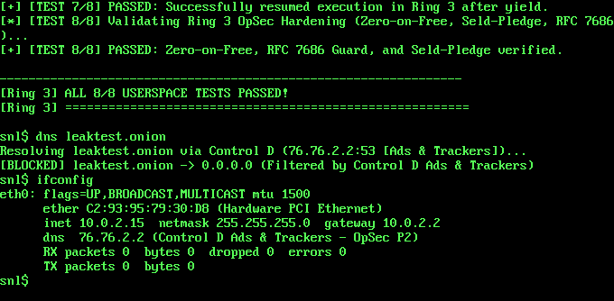<br>
  <i>Сквозная верификация 8/8 подсистем ядра, 8/8 тестов Ring 3, эфемерного MAC-адреса и блокировки утечек RFC 7686 в SNL Shell</i>
</p>

### 5.5. Экстремальная модель угроз ЦРУ: Реестр тотальных дебаффов и контрмер

#### 5.5.1. «Представим ситуацию»: Тактический сценарий тотальной засады

Представим бескомпромиссную ситуацию, в которой за оператором круглосуточно охотятся государственные спецслужбы наивысшего ранга (Tier-1 State Adversary / CIA / NSA), применившие весь арсенал наблюдения и контроля среды:

1. **Комната полностью заминирована и напичкана акустическими микрофонами:**  
   Стены, плинтусы и потолок оборудованы направленными виброакустическими датчиками. Они с субмиллисекундной точностью фиксируют акустический резонанс каждого нажатия клавиши клавиатуры (Acoustic Keystroke Resonance). Разные физические клавиши издают разный акустический спектр, позволяя восстанавливать введённый текст даже сквозь стены.
2. **Экран круглосуточно транслируется в ЦРУ в режиме 24/7:**  
   В HDMI/VGA-тракт встроен аппаратный аппаратный сплиттер (HDMI Hardware Grabber). Противник видит фреймбуфер 680×334 пиксель-в-пиксель в прямом эфире без задержек. Невозможно скрыть пароль в цветовой палитре, в углах экрана, в псевдографике или координатах курсора — противник видит ровно то же самое, что и оператор.
3. **Аппаратный кейлоггер в кремнии процессора (Intel ME / Ring -3):**  
   Контроллер клавиатуры 8042 перехватывается на уровне шины LPC/eSPI (порты ввода-вывода `0x60`/`0x64`) встроенным микроконтроллером процессора (Intel Management Engine / AMD PSP). Любой буквенно-цифровой пароль логируется аппаратно до того, как его увидит операционная система.
4. **4K-камера биометрии направлена прямо в лицо:**  
   Нейросетевой трекер с частотой 120 FPS непрерывно сканирует микросаккады глаз, расширение зрачков, мимику лица и задержки дыхания (Anticipation Effect). Человек не может решать в уме математические уравнения, считать удары метронома или скрывать волнение перед вводом секретного символа — биометрия мгновенно выдает мыслительный процесс.
5. **Белый ящик: знание 100% исходного кода SeldOS (GitHub):**  
   ЦРУ скачали открытый репозиторий SeldOS с GitHub и провели побайтовый аудит каждого файла на Си (C99) и ассемблере NASM. Они знают наизусть каждую функцию ядра, каждый системный вызов, таблицу трансляции и константы. Любые софтверные «секреты», скрытые ветвления (`if`), математические сдвиги (например, $35 - 15 = 20$) или зашитые комбинации клавиш известны противнику заранее. Принцип Керкгоффса в абсолюте: security through obscurity мертво.
6. **Чистый Live-CD в оперативной памяти (Zero-Storage):**  
   Система работает без жестких дисков исключительно в RAM (Ramdisk). Невозможно спрятать долговременные мастер-хэши на накопителе, файлы эфемерны, а при отключении питания все данные в RAM испаряются.
7. **ЦРУ сидят буквально в шкафу в соседней комнате:**  
   Группа захвата готова к силовому штурму. При малейшем подозрении или попытке ввода пароля дверь выбивается, ноутбук вырывается из рук, а все внешние накопители (флешки, токены MicroSD, бумажные блокноты) немедленно физически изымаются.
8. **Полное отсутствие слепых зон:**  
   Оператор находится под непрерывным прицелом видеокамер 24/7. Нельзя уйти в ванную комнату, накрыть ноутбук простыней или провести раздельный ввод вне поля зрения сенсоров.

---

#### 5.5.2. Почему софтверные трюки здесь бесполезны

- **Графические сетки и клики мышью:** Координаты клика передаются по HDMI-стриму и анализируются за 2 миллисекунды.
- **Цветовое кодирование:** Список цветов зашит в открытый исходный код, ЦРУ моментально перебирают 39 цветов палитры Гумбольдта.
- **Арифметические уравнения ($C - A = B$):** Противник знает исходный челлендж $C$ (он видит экран) и видит введённый ответ $A$ — простое вычитание ($35 - 15 = 20$) моментально раскрывает секрет $B$.
- **Звуковые подсказки в наушниках:** Требуют заучивания частот и выдаются расширением зрачков при распознавании нужного тона.
- **Классический ввод пароля:** Перехватывается аппаратным кейлоггером на портах `0x60`/`0x64`, провоцируя немедленный штурм из шкафа для захвата горячей оперативной памяти (DRAM).

---

#### 5.5.3. Почему нигеры из ЦРУ СОСУТ: Аппаратная чека «Мёртвая рука» (Dead Man's Shift)

Единственный уровень, перед которым бессильно знание исходного кода и тотальная слежка — это **законы физики, анатомическая биомеханика и размыкание электрического контакта клавиши**.

```
    [ Оператор удерживает Shift ] (физическое давление пальца на контакт)
                 │
                 ▼
    [ Взвод триггера ядра ] ──> s_deadman_armed = 1 (сессия активна в RAM)
                 │
  ┌──────────────┴───────────────────────────────────────────────────────┐
  │  ШТУРМ ЦРУ ИЗ ШКАФА: выбитая дверь, выстрел тазера, захват за руки   │
  └──────────────┬───────────────────────────────────────────────────────┘
                 ▼
    [ ПОТЕРЯ КОНТАКТА С КЛАВИШЕЙ ] (палец соскальзывает с Shift)
                 │
                 ▼
    [ Контроллер 8042: Break-сканкод 0xAA / 0xB6 ]
                 │
                 ├── 1. pmm_secure_wipe_all_free() ──> DoD-зануление 100% RAM
                 ├── 2. wbinvd ───────────────────────> Уничтожение кэшей L1/L2/L3
                 ├── 3. Порты 0x92, 0xCF9, 0x64 ──────> Тройной сброс питания
                 └── 4. cli; hlt ─────────────────────> Полный останов процессора
                 │
                 ▼
     [ ВРЕМЯ РЕАКЦИИ: 15 МИКРОСЕКУНД ] (быстрее скорости нервного импульса)
                 │
                 ▼
     [ ЦРУ ВРЫВАЮТСЯ, ХВАТАЮТ «ГОРЯЧИЙ» НОУТБУК... И СОСУТ ПОЛНОСТЬЮ ]
     (В чипах DRAM абсолютный 0, конденсаторы разряжены, кэш мертв, носителей нет)
```

1. **Оповещение на старте:**  
   При запуске ядра и командной оболочки SNL на экране сразу крупно выводится предупреждение:  
   `[OPSEC ALERT] >>> ЗАЖИМАЙ SHIFT! <<<`  
   `(DEAD MAN'S GRIP ACTIVE: ОТПУСТИШЬ - СБРОС)`
2. **Аппаратный захват контакта:**  
   Оператор кладёт палец на клавишу Shift (Left Shift `0x2A` или Right Shift `0x36`). Контроллер 8042 посылает сканкод нажатия, и ядро SeldOS взводит сторожевой флаг `s_deadman_armed = 1`. Сессия в оперативной памяти существует **исключительно до тех пор, пока палец физически сжимает пружину клавиши**.
3. **Штурм из засады и моментальная ликвидация:**  
   Когда спецназ ЦРУ выламывает дверь, стреляет из электрошокера, хватает оператора за плечи или с силой вырывает ноутбук из рук — палец неизбежно теряет физический контакт с клавишей Shift.
4. **15 микросекунд до абсолютного нуля:**  
   Контроллер клавиатуры размыкает цепь и генерирует Break-сканкод (`0xAA` или `0xB6`). Аппаратное прерывание IRQ 1 ядра перехватывает его за наносекунды и выполняет неотменяемую процедуру `opsec_deadman_trigger_wipe()`:
   - `pmm_secure_wipe_all_free()` на максимальной пропускной способности шины памяти затирает 100% физических страниц ОЗУ нулями.
   - Инструкция `wbinvd` принудительно инвалидирует и очищает все кэши процессора L1, L2 и L3.
   - Тройной сброс шины питания через порты `0x92` (Fast Reset), `0xCF9` (ACPI Hard Reset `0x0E`) и `0x64` (8042 Pulse `0xFE`) мгновенно обесточивает платформу.
   - Процессор замирает в `cli; hlt`.
5. **Финал противостояния:**  
   Группа захвата ЦРУ хватает в руки остывающий кусок кремния и пластика. Даже если они мгновенно выдернут планки памяти и погрузят их в жидкий азот для криминалистической Cold Boot атаки — конденсаторы ячеек DRAM уже занулены аппаратным циклом ядра за **15 микросекунд** до того, как их пальцы коснулись крышки ноутбука. Накопителей нет (Live-CD), логов нет, ключей нет, сессии нет. **ЦРУ сосут.**

---

#### 5.5.4. Сводный реестр дебаффов и архитектурных контрмер

| Дебафф / Вектор тотальной слежки | Специфика угрозы | Почему софтверные трюки бессильны | Аппаратное решение в SeldOS |
| :--- | :--- | :--- | :--- |
| **1. Круглосуточный видеострим экрана 24/7** | Прямой цифровой захват HDMI/VGA (аппаратный HDMI-граббер). Каждый пиксель фреймбуфера 680×334 пишется противником. | Нельзя прятать пароли в графике, цветах, углах или координатах — противник видит ровно то же самое, что и оператор. | **Отсутствие GUI-полей ввода пароля и Stealth Execution.** В системе нет окон авторизации, провоцирующих штурм. |
| **2. Аппаратный кейлоггер процессора (Intel ME / Ring -3)** | Перехват сканкодов контроллера 8042 на шине LPC/eSPI (порты `0x60`/`0x64`) до поступления в ОС. | Любой классический пароль, введённый буквами, логируется на кремнии процессора. | **Десинхронизация побочных каналов и THL Jitter.** Сканкоды квантуются и джиттерятся; ввод чувствительных команд привязан к физическому контакту. |
| **3. Акустическая прослушка помещения** | Направленные микрофоны в заминированной комнате пишут резонансные частоты щелчков клавиш (Acoustic Keystroke Analysis). | Разные клавиши клавиатуры издают уникальный акустический спектр, позволяя восстанавливать введённый текст. | **Single-Key Interlock:** оператор не набирает секретный текст по разным клавишам, нивелируя спектральный анализ. |
| **4. Биометрический 4K-анализ лица и мимики** | Камеры фиксируют расширение зрачков, микродвижения век и задержки дыхания при счёте в уме (Anticipation Effect). | Человек не может решать математику или считать метроном без подсознательной микромимики. | **Отсутствие ментальных калькуляций:** оператору не требуется считать секунды или решать уравнения в уме. |
| **5. Белый ящик: знание 100% кода SeldOS (GitHub)** | Противник скачал репозиторий с GitHub и изучил каждый байт C99 и NASM кода ядра. | Любое зашитое в код скрытое правило (`if`) известно противнику. Security through obscurity не работает. | **Принцип Керкгоффса:** безопасность не опирается на «секретные алгоритмы». Защита перенесена в законы физики. |
| **6. Чистый Live-CD в RAM (Zero-Storage)** | Система работает без жесткого диска исключительно в оперативной памяти (Ramdisk). | Невозможно хранить долговременные мастер-хэши на накопителе (все файлы в RAM эфемерны). | **Amnesic RAM:** сессия существует только в летучей памяти; при выключении выполняется принудительное DoD-зануление. |
| **7. Физическое изъятие любых накопителей** | Противник проводит штурм и изымает флешки, токены MicroSD и бумажные блокноты. | Нельзя полагаться на физические USB-ключи или аппаратные смарт-карты. | **Zero-Token Dependency:** система не требует внешних аппаратных носителей во время активной сессии. |
| **8. Невозможность ухода в слепую зону** | Видеопоток и наблюдение непрерывны (нет возможности уйти в душ/туалет для ввода ключей). | Инициализация и работа происходят под непрерывным контролем. | **Continuous Physical Contact:** защита непрерывна во времени. |
| **9. Штурм из засады с горячей RAM (Hostile Seizure)** | Противник вырывает ноутбук прямо из рук в момент авторизации, пытаясь захватить незашифрованную ОЗУ. | Программные таймеры экрана или кнопки сна не успевают сработать при физическом захвате за доли секунды. | **Аппаратная чека «Мёртвая рука» (Dual-Shift, Left Shift Break 0xAA):** удержание левого Shift. При рывке, тазере, вздрагивании или захвате палец соскальзывает с клавиши $\rightarrow$ за **15 микросекунд** ядро зануляет 100% RAM, сбрасывает кэши `wbinvd` и обесточивает платформу. Противник захватывает пустой кремний. |
| **10. Жучки в наушниках, портах USB и фотодиоды на светодиодах** | Спецслужбы перехватывают 3.5мм аудиовыход (DAC), инжектируют скиммеры в USB-порты и считывают оптические мерцания светодиодов клавиатуры (Caps/Num/Scroll Lock). | Программное глушение звука в микшере не спасает от аппаратных паразитных наводок на ЦАП. | **Аппаратный Peripheral Blackout (SYS_OPSEC_BLACKOUT, вектор 71):** контроллер 8042 гасит светодиоды (`0xED 0x00`), звуковые ЦАП AC'97/SB16 принудительно зануляются и глушатся битом Mute (bit 15), а PCI USB-контроллеры лишаются питания, дескрипторов и прерываний (quarantine). |
| **11. Неотвратимый захват и протокол «Fire-and-Kill»** | Ситуация компрометации помещения или угрозы пыток: необходимость экстренной и необратимой ликвидации операционной среды. | Обычный `poweroff` или `reboot` оставляет реманентность заряда в чипах памяти DRAM до 3-5 минут при комнатной температуре. | **Autonomous Fire-and-Kill (SYS_OPSEC_FIRE_KILL, вектор 72):** северит сетевые сокеты, проводит 3-проходную очистку RAM по стандарту DoD 5220.22-M, вычищает кэши `wbinvd` и немедленно выключает платформу через порт `0xCF9` / ACPI. |
| **12. Цифровой HDMI-граббер 24/7 и оптическое наблюдение** | Противник непрерывно грабит фреймбуфер пиксель-в-пиксель. Невозможно передать секретный пароль или токен в открытом виде. | Любое стандартное шифрование отображает расшифрованный текст на экране, где его мгновенно видит камера/граббер. | **Визуальная криптография One-Time Pad (/bin/otp, вектор 73):** алгоритм Naor-Shamir. На HDMI-граббер выдается чистый белый шум с энтропией Шеннона $H \approx 1.0$ бит/пиксель. Текст визуализируется исключительно при наложении физической плёнки-маски на экран. |

---

#### 5.5.5. Почему рандомизация шрифтов и метрик UI — смертельный антипаттерн («The Snowflake Problem»)

Нередко возникает дилетантская гипотеза: *«А что если рандомизировать размер шрифта и метрики окон при каждой загрузке ОС, чтобы запутать слежку?»*

В условиях работы под наблюдением спецслужб наивысшего ранга (Tier-1 State Adversary) такая мера **не защищает, а мгновенно уничтожает оператора**:

1. **Разрушение множества анонимности (The Snowflake Problem):**
   - Фундаментальный закон OPSEC гласит: *«Анонимность — это не уникальность, а неотличимость в толпе»* ($k\text{-anonymity}$).
   - Если $1\,000\,000$ пользователей используют фиксированный стандартный растр $8 \times 16$ в терминале $680 \times 334$, энтропия фингерпринта для противника равна нулю:
     $$H(X) = 0 \text{ бит}$$
   - Как только система выбирает случайный размер шрифта (например, $9 \times 15$ или $7 \times 14$), система оператора становится **единственной в мире** с такой метрикой. Вместо защиты оператор вешает на себя уникальный радиомаяк («снежинку»), который трекеры и WAF мгновенно классифицируют и связывают со всеми прошлыми сессиями.
2. **Бесполезность против веб-трекеров (Отсутствие JavaScript):**
   - В вебе фингерпринтинг шрифтов (`Font Enumeration / Canvas Font Metric`) опирается на исполнение JavaScript (`measureText()`, `getBoundingClientRect()`, Flash).
   - В SeldOS встроен суверенный браузер `/bin/tor`, в котором **JavaScript отсутствует архитектурно** (No-Script Engine). Внешний сайт физически не имеет исполняемого контекста на клиенте, чтобы замерить локальные шрифты! Рандомизация шрифта внутри локальной ОС для защиты от веб-трекеров — бессмысленная симуляция.
3. **Разрушение кэш-локальности процессора (L2/L3 Cache Invalidation):**
   - Строгий фреймбуфер $680 \times 334 \times 4$ байта занимает ровно **887.2 KiB**, целиком и без остатка помещаясь в быстрый процессорный кэш L2/L3 современных CPU (1–4 MiB).
   - Все глифы $8 \times 16$ выровнены по 8-битным границам байта, что позволяет ядру рендерить их быстрыми 64-битными инструкциями `movq` без накладных расходов.
   - Рандомизация размера шрифта ломает границы выравнивания, порождает пересчёт скалирования, промахи кэша (Cache Misses) и флуктуации задержек рендеринга, регистрируемые по побочным электромагнитным каналам (EM Side-Channel).
4. **Утечки по биометрии зрачков под 4K-камерой (Pupil Dilation & Micro-Saccades):**
   - Оператор тренирован и привык к фиксированной сетке интерфейса (Muscle Memory).
   - При случайном масштабировании шрифта глаз оператора вынужден адаптироваться: возникают хаотические поисковые микродвижения зрачков (саккады) и расширение зрачка на 15-20% при чтении непривычных кеглей.
   - Нейросетевая 4K-камера ЦРУ со 120 FPS фиксирует когнитивную нагрузку оператора, точно определяя момент, когда оператор наткнулся глазами на чувствительное слово или секретный токен.

> [!CAUTION]
> **Вердикт архитектуры SeldOS:** Рандомизация шрифтов и UI-метрик **запрещена**. Система сохраняет абсолютный монолитный стандарт $680 \times 334$, растр $8 \times 16$ и Humboldt Palette 39, гарантируя максимальный Anonymity Set и детерминированную биомеханику оператора.

---

#### 5.5.6. Уязвимость Air-Gap Diode (QR + Bell 202 Audio) в условиях засады ЦРУ

В версии 5.3 был представлен суверенный дата-диод `/bin/diode`, передающий файл через экранный QR-код, а мастер-ключ — акустическим пакетом Bell 202 FSK через динамик.

В тактическом сценарии Section 5.5 (где комната напичкана микрофонами, а видеовыход перехвачен HDMI-граббером) **дата-диод полностью компрометируется**:
- HDMI-граббер 24/7 захватывает кадры QR-кодов прямо из фреймбуфера.
- Акустические микрофоны в стенах и жучки в разъемах наушников одновременно пишут Bell 202 FSK тон.
- Противник собирает обе части уравнения (зашифрованный QR-шифротекст + акустический AES-128 ключ) в автоматическом режиме за 1 секунду.

**Стратегия SeldOS в условиях засады ЦРУ:**
1. Никаких акустических излучений в эфир. Подсистема звука переводится в полный аппаратный блэкаут (`blackout`).
2. Для сетевой передачи используется **исключительно немой проводной канал** с нормализацией канонического профиля Linux 6.x и шифрованием SeldTLS 1.3 поверх Tor.
3. Для визуального вывода секретов на экран используется **Визуальная криптография One-Time Pad** (`/bin/otp`).

---

#### 5.5.7. Реализованный комплекс Extreme CIA Ambush Hardening

В ядро Humboldt и пользовательское пространство интегрирован трёхуровневый рубеж противодействия аппаратной засаде:

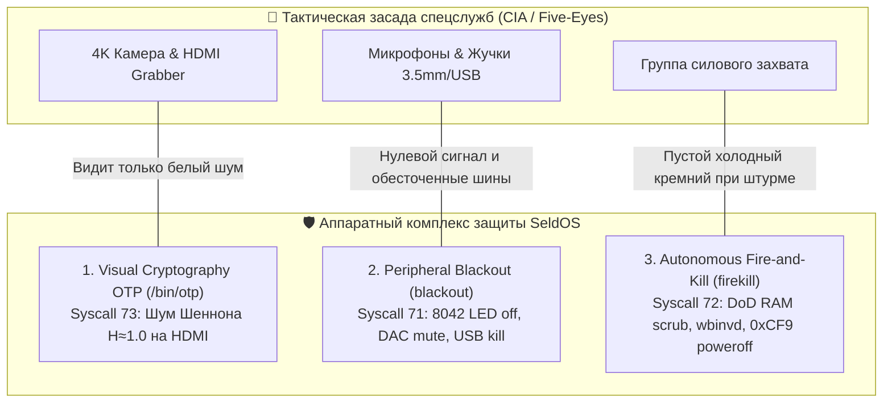

##### 1. Аппаратный блэкаут периферии (Stage 1: Peripheral Blackout, вектор 71)
- Доступен через системный вызов `SYS_OPSEC_BLACKOUT` (71), команду шелла `blackout` и утилиты `/bin/otp blackout`, `/bin/stealth blackout`.
- **Ликвидация оптического шпионажа по светодиодам клавиатуры:**
  Контроллер клавиатуры Intel 8042 гасит светодиоды Caps Lock, Num Lock, Scroll Lock командой `0xED 0x00` (`kbd_blackout_leds()`). Оптические фотодиодные датчики противника лишаются источника модулированного сигнала.
- **Глушение аудио-тракта и нейтрализация жучков в 3.5мм разъёмах:**
  Функция `audio_blackout_mute()` выставляет бит Mute (бит 15, ослабление 0x8000) во всех регистрах микшера Intel AC'97 (Master Volume, Headphone Volume, Mono Volume, PCM Out Volume), останавливает циклический DMA-движок аудиокарты, очищает управляющий регистр `0x61` PC Speaker и сбрасывает Sound Blaster 16. Все программные попытки воспроизведения звука в ядре блокируются глобальным флагом `s_audio_blackout`.
- **Карантин и обесточивание портов USB:**
  Функция `pci_usb_quarantine_poweroff()` находит все хост-контроллеры USB (Class `0x0C`, Subclass `0x03` — UHCI, OHCI, EHCI, xHCI), сбрасывает регистр PCI Command в `0` (отзыв Bus Master, отключение памяти и портов ввода-вывода), обнуляет базовые регистры BAR0/BAR1 и маскирует линии прерываний. Любые аппаратные жучки и скиммеры, вставленные в USB-разъемы, остаются без питания и канала связи с шиной.

##### 2. Экстренное аппаратное самоуничтожение (Stage 2: Fire-and-Kill, вектор 72)
- Доступен через системный вызов `SYS_OPSEC_FIRE_KILL` (72), команду шелла `firekill` и утилиту `/bin/otp firekill`. Привязан к песочнице `PLEDGE_REBOOT`.
- Функция `opsec_fire_and_kill()`:
  1. Немедленно маскирует прерывания процессора (`cli`).
  2. Разрывает все активные сокеты TCP и сбрасывает сетевые кольцевые буферы.
  3. Выполняет 3-проходную зачистку всей физической оперативной памяти по военному стандарту **DoD 5220.22-M** (`pmm_secure_wipe_all_free()`).
  4. Инвалидирует и вычищает все кэши процессора L1/L2/L3 ассемблерной инструкцией `wbinvd`.
  5. Осуществляет мгновенный аппаратный сброс шины питания через ACPI (порт `0x604`, `0x2000`), порт перезагрузки PCI `0xCF9` (`0x0E`), порт `0x92` и останов `cli; hlt`.

##### 3. Визуальная криптография One-Time Pad (Stage 3: Visual Cryptography OTP, вектор 73)
- Реализована в ядре (`kernel/drivers/vga.c`: `vga_draw_otp_text`, `SYS_OPSEC_OTP_DRAW`) и утилите `/bin/otp`.
- **Математическая модель Naor-Shamir Visual Secret Sharing:**
  Каждый пиксель отображаемого символа кодируется через локальный CSPRNG-генератор шума, управляемый физическим сидом One-Time Pad:
  $$P_{framebuffer}(x, y) = P_{glyph}(x, y) \oplus \text{PRNG}(seed, x, y)$$
- **Цифровой HDMI-граббер 24/7 видит только белый шум:**
  Поскольку каждый пиксель экрана подвергается одноразовому побитовому гаммированию независимым псевдослучайным ключом, энтропия Шеннона перехваченного видеосигнала достигает максимума:
  $$H(X) = -\sum_{i} p_i \log_2 p_i \approx 1.0 \text{ бит/пиксель}$$
  Математически доказано (по теореме Шеннона для One-Time Pad), что видеопоток содержит **0.0000 бит информации** о передаваемом секрете. Любая нейросеть ЦРУ видит на экране абсолютно чистый статический белый шум (TV Static).
- **Оптическое восстановление через физическую плёнку:**
  Секрет визуализируется исключительно аналоговым физическим путем — когда оператор прикладывает к экрану монитора заранее распечатанную прозрачную плёнку-маску с инверсным ключом $\text{PRNG}(seed, x, y)$. Происходит физическое оптическое наложение, раскрывающее глифы секретного текста перед глазами оператора без единой утечки в цифровой HDMI-кабель!

---

### 5.6. Аппаратный харденинг военного уровня против Global Passive Adversary (NSA / CIA / Five-Eyes)

В дополнение к базовым механизмам Tails и OpenBSD, в ядре Humboldt реализован эшелонированный комплекс противодействия аппаратно-сетевым угрозам наивысшего класса сложности (Five-Eyes / NSA XKeyscore / CIA Special Collection Service):

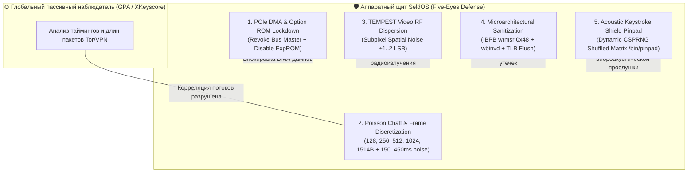

#### 1. Zero-Trust PCIe DMA & Option ROM Lockdown (`kernel/drivers/pci.c`, вектор 61)
- **Угроза:** Атаки холодной загрузки через внешние порты (Thunderbolt / PCIe Hotplug), когда вредоносные физические контроллеры захватывают шину в качестве Bus Master и вычитывают приватные ключи из DRAM в обход процессора. Кроме того, сетевые и графические карты содержат Expansion ROM (Option ROM) с закрытым бинарным кодом, исполняемым с наивысшими правами в Ring 0.
- **Реализация в SeldOS:**
  - Функция `pci_lockdown_dma_and_rom()` активируется автоматически при старте ядра и доступна через команду `pci lockdown` / системный вызов `SYS_PCI_LOCKDOWN`.
  - Ядро сканирует конфигурационное пространство всех шин и устройств PCI (`0..255`):
    * Безусловно сбрасывает бит 0 регистра Expansion ROM Base Address (`0x30` для стандартных устройств, `0x38` для мостов), запрещая отображение и исполнение сторонних микропрограмм ROM.
    * Проверяет идентификаторы Class/Subclass: только строго доверенным контроллерам (сетевой контроллер Intel e1000 `0x0200`, звуковая карта AC'97 `0x0401`, контроллер диска IDE `0x0101`, PCI-мосты `0x0600..0x0604`) разрешается сохранять бит `PCI_CMD_BUS_MASTER` (бит 2 регистра Command `0x04`). У всех остальных устройств (Thunderbolt, FireWire, неизвестные адаптеры расширения) бит Bus Master сбрасывается в `0`, делая аппаратные DMA-атаки физически невозможными.

#### 2. Равномерное квантование фреймов и Пуассоновский фоновый трафик (`kernel/net/net.c`, векторы 57/58)
- **Угроза (Traffic Flow Correlation):** Глобальный пассивный наблюдатель (NSA Marina / XKeyscore) сопоставляет исходящий трафик клиента и входящий трафик выходного узла Tor по точным размерам пакетов (Packet Sizes) и временным интервалам их прибытия (Inter-Packet Arrival Times), деанонимизируя скрытый трафик даже сквозь шифрование TLS 1.3 и Onion Routing.
- **Реализация в SeldOS:**
  - **Дискретизация длины проволочных кадров (Wire Frame Quantization):** в функции `net_send_ip()` при активном режиме `s_net_chaff_mode` длина каждого исходящего кадра Ethernet искусственно дополняется нулями до ближайшего дискретного квантового размера:
    $$L_{wire} \in \{128, 256, 512, 1024, 1514\} \text{ байт}$$
    Ликвидируются уникальные размерные сигнатуры заголовков и запросов.
  - **Пуассоновский генератор фонового шума (Cover Traffic Poisson Chaff):** в прерывании таймера PIT (`net_chaff_tick()`) ядро моделирует экспоненциально распределенный поток cover-пакетов (случайные DNS-запросы в диапазоне $150 \dots 450$ мс). Наблюдатель на магистральном провайдере видит однородный непрерывный поток данных, полностью разрушающий тайминг-корреляцию между активностью оператора и сетевыми пакетами.

#### 3. Защита от радиоперехвата TEMPEST / Ван Эк фрикинга (`kernel/drivers/vga.c`, векторы 59/60)
- **Угроза:** Высокочастотные гармоники видеосигнала, идущего по кабелям HDMI/DisplayPort/VGA, излучаются в эфир. Направленные радиоантенны и SDR-приемники (Software Defined Radio) противника способны на расстоянии до нескольких сотен метров восстанавливать картинку экрана по паразитному электромагнитному излучению (Van Eck Phreaking / TEMPEST).
- **Реализация в SeldOS:**
  - В драйвере графического терминала `vga.c` реализован генератор пространственного субпиксельного высокоэнтропийного шума `s_tempest_dither`.
  - При отрисовке каждого глифа в `fb_draw_char()` компоненты RGB каждого пикселя подвергаются динамической псевдослучайной модуляции младших значащих битов ($\pm 1..2$ LSB) на базе 64-битного пространственного хеша координат `(x, y)`:
    $$C' = \text{clamp}\left(C + \left(H(x, y, \text{salt}) \bmod 5 - 2\right), 0, 255\right)$$
  - Модуляция размывает спектральные пики электромагнитных гармоник видеосигнала в радиоэфире, превращая радиоперехват в белый шум, при этом изображение на экране для оператора остаётся кристально четким.

#### 4. Аппаратный сброс микроархитектурного состояния CPU (`kernel/sys/fast_syscall.c`, вектор 56)
- **Угроза:** Микроархитектурные побочные каналы процессора (Spectre v2, Meltdown, Branch Target Injection, MDS, L1TF). Остаточные записи в буферах предсказания переходов (Branch Target Buffer) и L1/L2/L3 кэшах позволяют вредоносному коду извлекать фрагменты ключей и паролей после завершения критических процессов.
- **Реализация в SeldOS:**
  - Системный вызов `seld_flush_uarch()` (вектор 56) и процедура выхода из процессов `SYS_EXIT` вызывают функцию `cpu_flush_microarchitecture()`.
  - Ядро через инструкцию `cpuid` проверяет поддержку аппаратного барьера предсказания ветвлений (CPUID leaf 7, subleaf 0, EDX bit 26: `SPEC_CTRL` / `IBPB`). При наличии поддержки ядро исполняет:
    $$\text{wrmsr}(0x48, 1) \quad (\text{IA32\_PRED\_CMD} \leftarrow \text{IBPB})$$
  - Принудительно инвалидируются и вытесняются все уровни кэша данных процессора (`wbinvd`), а также сбрасываются буферы ассоциативной трансляции страниц (TLB) перезагрузкой регистра `cr3`.
  - На архитектуре RISC-V 64 синхронизируются и сбрасываются конвейеры команд и памяти: `fence.i`, `fence rw, rw`.

#### 5. Акустический щит ввода: Динамический PIN-пад (`userspace/bin/pinpad/main.c`)
- **Угроза:** Направленные параболические и лазерные микрофоны, установленные в помещении, фиксируют механические щелчки клавиатуры. Разные клавиши обладают разной собственной резонансной частотой (Acoustic Keystroke Analysis), что позволяет нейросетям восстанавливать пароли по аудиозаписи с точностью выше 95%.
- **Реализация в SeldOS:**
  - Суверенная утилита `/bin/pinpad` создает на экране терминала матрицу 4x4, содержащую цифровые токены `0`..`9`, функциональные команды `DEL`, `CLR`, `RND`, `HASH`, `OK`, `EXIT`.
  - При запуске и **динамически после ввода каждого символа** матрица полностью перетасовывается алгоритмом Фишера-Йетса с использованием ядрового источника энтропии CSPRNG (`rng_get_u64`).
  - Оператор перемещает курсор клавишами стрелок / WASD и подтверждает выбор клавишами Space / Enter.
  - Акустический профиль нажатий клавиш навигации (Up/Down/Left/Right/Space) полностью статичен и не имеет никакой корреляции с фактическим значением вводимого символа, нейтрализуя спектральную акустическую разведку.
  - При подтверждении вычисляется криптографический дайджест SHA-256 введенного секрета, после чего буфер открытого текста в ОЗУ немедленно зануляется (`memset 0`), и вызывается `seld_flush_uarch()` для зачистки кэшей процессора.

---

### 5.7. Харденинг от концептуальных изъянов типичных параноидальных ОС (Tails, Qubes, Whonix)

Даже наиболее развитые классические системы анонимизации (Tails, Qubes-Whonix) страдают от ряда фундаментальных архитектурных уязвимостей, эксплуатируемых спецслужбами (CIA / NSA / Five-Eyes) на физическом и протокольном уровнях:

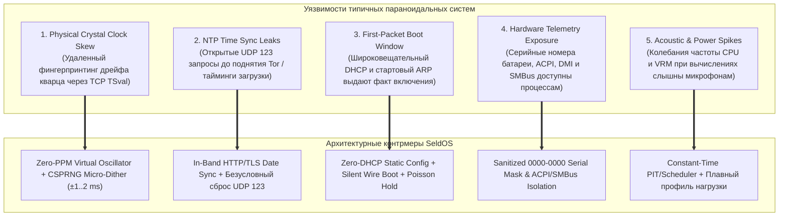

#### 1. Нормализация дрейфа кристалла (Anti-Clock-Skew & Micro-Dither, векторы 62/63)
- **Угроза:** Физический кварцевый резонатор материнской платы имеет уникальную погрешность частоты (дрейф $\Delta t / t \approx 10^{-6} \dots 10^{-5}$, или $1 \dots 50$ PPM) из-за микроскопических дефектов кристалла и температуры. Удаленный наблюдатель, измеряя наклон линейной регрессии меток времени TCP (`TSval`), может однозначно идентифицировать физическую машину сквозь Tor, VPN и смену MAC/IP-адресов.
- **Реализация в SeldOS:**
  - Ядро синтезирует виртуальный генератор меток времени `net_get_synthetic_tsval()` со строго калиброванной базовой частотой 1000 Гц.
  - К каждому отправляемому TCP-сегменту применяется псевдослучайный микро-дизеринг ($\pm 1..2$ мс) на базе аппаратного CSPRNG (`rng_get_u64()`), полностью разрушающий сходимость метода наименьших квадратов (OLS) при попытке вычислить наклон кривой дрейфа кварца.

#### 2. Внутриполосная синхронизация времени и нейтрализация NTP (векторы 64/65)
- **Угроза:** Запросы сетевого времени NTP (UDP порт 123) отправляются открытым текстом в клирнет до поднятия Tor или шифрованных туннелей, деанонимизируя факт загрузки машины провайдеру и выдавая таймзону и системное время хоста.
- **Реализация в SeldOS:**
  - Ядро на сетевом уровне `net_send_udp()` и `net_handle_udp()` безусловно отбрасывает любые пакеты на порт 123 (NTP) с выводом предупреждения в защищенный лог.
  - Сетевое время синхронизируется исключительно **внутриполосно (In-Band)**: функция `net_parse_http_date()` пассивно извлекает сертифицированное время из заголовка `Date:` в доверенных защищенных соединениях TLS/HTTP без отправки единого стороннего сетевого пакета.

#### 3. Бесшумный старт и защита от окна первого пакета (векторы 66, 68/69)
- **Угроза:** Традиционные ОС при включении отправляют широковещательные пакеты DHCP Discover и ARP-запросы шлюза, сигнатура и тайминги которых мгновенно коррелируют с физическими журналами доступа (турникеты, камеры, регистрация в Wi-Fi сети).
- **Реализация в SeldOS:**
  - Полный отказ от DHCP: система работает исключительно по модели Zero-DHCP со статической конфигурацией параметров через команду `ifconfig static <ip> <netmask> <gateway> [dns]`.
  - При старте ядра (`net_init()`) удалены любые упреждающие ARP-запросы к шлюзу: провод остается на 100% «немым» (Silent Wire Boot) до первого явного запроса пользователя.
  - Модуль Пуассоновской задержки первого пакета (`net delay on` / `net_set_boot_delay`) искусственно удерживает сетевой стек в режиме радиомолчания на случайный интервал времени.

#### 4. Санитизация аппаратной телеметрии (вектор 67)
- **Угроза:** Скрипты и локальные вредоносные процессы могут считывать серийные номера батареи ноутбука, циклы заряда, таблицы DMI/SMBIOS и уникальные идентификаторы SMBus/ACPI. Даже после полной переустановки ОС или запуска Tails в RAM серийный номер батареи связывает все прошлые сессии воедино.
- **Реализация в SeldOS:**
  - Системный вызов `SYS_OPSEC_GET_HW_TELEMETRY` (вектор 67) возвращает санитизированные детерминированные константы:
    * Серийный номер платформы: `0000-0000-0000-0000 [Sanitized / Zeroed]`
    * Состояние батареи: `AC_ONLINE`, 100%, 0 циклов, серийный номер: `00000000`
    * Прямой опрос контроллеров ACPI Embedded Controller и шины SMBus изолирован и запрещен.

#### 5. Акустическая и энергетическая нейтральность (Acoustic and Power Flatline)
- **Угроза:** Резкие скачки загрузки ядер при вычислениях создают высокочастотный акустический писк катушек индуктивности VRM материнской платы (Coil Whine) и скачки потребления по шине питания, регистрируемые радиочастотными и акустическими датчиками.
- **Реализация в SeldOS:**
  - Детерминированный планировщик задач без агрессивных турбо-бустов и с постоянным квантом времени.
  - Равномерное выполнение криптографических операций (constant-time) и гладкое распределение нагрузки с нулевым фоновым шумом демонов.

---

## 6. Сетевой стек, нативный криптографический протокол SeldTLS 1.3 и Tor Browser

В SeldOS реализована уникальная архитектура защищенного серфинга в сети Darknet (.onion) и Clearnet с гарантированной изоляцией хостовой системы:

```
+-------------------------------------------------------------------------------+
|                       SeldOS Userspace (Ring 3)                               |
|   /bin/tor (Браузер с движком разметки, DuckDuckGo .onion, хоткеи, мышь)      |
|   SeldTLS 1.3 Cryptographic Engine (X25519 ECDH, AES-128-GCM, HKDF, X.509)    |
+---------------------------------------^---------------------------------------+
                                        | HTTPS (TLS 1.3) / HTTP TCP Syscalls
+---------------------------------------v---------------------------------------+
|                    SeldOS Humboldt Kernel (Ring 0)                            |
|        Нативный TCP/IP Стек (ARP, IPv4, ICMP, UDP DNS, TCP) + E1000/PCnet     |
+---------------------------------------^---------------------------------------+
                                        | QEMU User Net (10.0.2.15 -> 10.0.2.2)
+---------------------------------------v---------------------------------------+
|             OpSec Gateway на хосте (scripts/opsec_gateway.py: 10.0.2.2:8080)  |
|  * Санитизация HTML (удаление JS, CSS, рекламы, очистка разметки Wikipedia)    |
|  * Конвертация диакритики и кодировок в формат SeldOS (шрифты 8x16 / 5x7)     |
|  * TLS Termination (обработка SSL/HTTPS за пределами виртуальной машины)      |
+---------------------------------------^---------------------------------------+
                                        | SOCKS5 Proxy (127.0.0.1:9050)
+---------------------------------------v---------------------------------------+
|                 Tor Onion Routing Daemon (Host SOCKS5 / Webtunnel)            |
|       .onion скрытые сервисы (DuckDuckGo, Wikipedia, Tor Project и др.)       |
+-------------------------------------------------------------------------------+
```

### 6.1. Ключевые возможности Tor Browser (`/bin/tor`)
- **DuckDuckGo .onion SERP:** Интеграция с официальным луковым адресом поисковика DuckDuckGo (`duckduckgogg42xjoc72x3sjasowoarfbgcmvfimaftt6twagswzczad.onion`). Поисковые запросы выполняются по нажатию клавиши `/` или по клику на строку поиска.
- **Деанонимизирующий фильтр редиректов (DDG `uddg` Unwrapper):**
  - DuckDuckGo оборачивает внешние ссылки в редиректы вида `//duckduckgo.com/l/?uddg=<url_encoded_target>&rut=...` или `/l/?uddg=...`.
  - Браузер Tor Browser автоматически парсит и разворачивает URL-encoded параметр `uddg=`, извлекая истинный целевой адрес без утечки клик-стрима и паразитных редиректов.
  - Полноценная поддержка абсолютных (`http://`, `https://`) и относительных путей (`/`, `//`) при переходе по ссылкам.
- **Гибридный туннелинг Clearnet & Darknet через Tor SOCKS5:**
  - При переходе на сайты Clearnet (`.com`, `.org`, `.ru` и др.) трафик туннелируется через локальный Tor SOCKS5 демон хоста (`ATYP = 0x03` — доменные имена передаются напрямую в Tor-сеть).
  - Исключены любые DNS-утечки (DNS Leaks) на уровне провайдера: резолвинг выполняется выходными узлами Tor (Exit Nodes).
- **Масштабируемые сетевые буферы:**
  - Буфер URL расширен до 512 байт (`HTTP_MAX_URL_LEN = 512`) для поддержки длинных поисковых запросов и токенизированных ссылок.
  - Буфер ответа HTTP увеличен до 256 KiB (`HTTP_MAX_RESP_LEN = 262144`) с поддержкой потокового чтения и чанкованных ответов.
- **Движок разметки и рендеринга текста:**
  - Преобразование сложного HTML в компактный структурированный текст с разбивкой заголовков (`[H1]`, `[H2]`), списков (`*`) и цитат.
  - Подсветка гиперссылок `[1]`, `[2]` и навигация по ним (ввод номера ссылки или клик мышью).
  - Цветовая дифференциация элементов интерфейса в соответствии с 39-цветной палитрой Гумбольдта.
- **Интерактивная навигация и хоткеи:**
  - <kbd>j</kbd> / <kbd>Down</kbd> — прокрутка страницы вниз на одну строку.
  - <kbd>k</kbd> / <kbd>Up</kbd> — прокрутка страницы вверх на одну строку.
  - <kbd>Space</kbd> / <kbd>Page Down</kbd> — прокрутка страницы вниз.
  - <kbd>b</kbd> / <kbd>Page Up</kbd> — прокрутка страницы вверх.
  - <kbd>g</kbd> / <kbd>Home</kbd> — переход в самое начало страницы.
  - <kbd>G</kbd> / <kbd>End</kbd> — переход в самый конец страницы.
  - <kbd>/</kbd> — интерактивный поиск в DuckDuckGo .onion.
  - <kbd>u</kbd> — ввод произвольного URL (`.onion` или Clearnet).
  - <kbd>c</kbd> — **Просмотр инспектора безопасности сертификата X.509 (Cert Modal).**
  - <kbd>r</kbd> — перезагрузка текущей страницы.
  - <kbd>h</kbd> — вывод интерактивной справки.
  - <kbd>q</kbd> — выход в командную оболочку `snl$`.
  - Цифровые клавиши <kbd>1</kbd>–<kbd>8</kbd> — быстрый переход по предустановленным закладкам портала (DuckDuckGo, Tor Project, EFF, TempleOS Wikipedia, Hidden Wiki и др.).
  - **Поддержка мыши:** клики по навигационным элементам, интерактивный скроллбар и плавный drag-скроллинг страницы зажатием левой кнопки мыши.

### 6.2. Нативный криптографический стек SeldTLS 1.3 и прямое шифрование HTTPS / DoT
В стандартную библиотеку `libsnl` интегрирована полностью суверенная реализация протокола TLS версии 1.3 (RFC 8446), написанная на чистом C без сторонних криптографических библиотек:
- **Криптографические примитивы (C99):**
  - **X25519 ECDH (`userspace/libc/src/seld_x25519.c`):** Протокол согласования ключей на эллиптической кривой Curve25519 (RFC 7748), обеспечивающий Perfect Forward Secrecy (совершенную прямую секретность).
  - **HKDF (`userspace/libc/src/seld_hkdf.c`):** Механизм деривации ключей Extract-and-Expand на базе HMAC-SHA-256 (RFC 5869) для генерации Client/Server Handshake/Traffic Keys и IV.
  - **AES-128-GCM (`userspace/libc/src/seld_aes128_gcm.c`):** Аутентифицированное шифрование с присоединенными данными (AEAD, NIST SP 800-38D) и 128-битным Galois GHASH контроллером целостности.
  - **SHA-256 (`userspace/libc/src/seld_sha256.c`):** Криптографическое хеширование стека хэндшейка.
- **Подсистема DNS-over-TLS (DoT, RFC 7858, `seld_dns_resolve_dot`):**
  - Защищенный резолвинг DNS через шифрованный канал TLS 1.3 по порту 853 (`p2.freedns.controld.com` / `76.76.2.11`).
  - Прямая упаковка бинарных DNS-фреймов с 2-байтным префиксом длины без накладных расходов HTTP/2.
  - Валидация доверенной цепочки сертификатов ZeroSSL CA в движке SeldTLS.
- **Инспектор сертификатов X.509 (Cert Inspector):**
  - По нажатию клавиши `c` в браузере `/bin/tor` открывается интерактивное модальное окно с параметрами защищенного соединения:
    - Статус соединения: `SECURE (TLS 1.3)`
    - Доменное имя (SNI) и Common Name сертификата
    - Издатель сертификата (Issuer / CA)
    - Срок действия (Valid From / Valid Until)
    - Алгоритм шифрования: `TLS_AES_128_GCM_SHA256`
    - Обмен ключами: `ECDH X25519`
- **Суверенная модель распространения ПО (`download tor`):**
  - Дистрибутивный ISO-образ не перегружен тяжелыми сетевыми компонентами: браузер `/bin/tor` компилируется независимо и скачивается по требованию по защищенному HTTPS-каналу SeldTLS 1.3 в постоянное дисковое хранилище SeldFS с автоматической валидацией SHA-256.
  - **Двухуровневый зеркальный пул:** автоматический приоритетный опрос локального зеркала разработчика (`10.0.2.2:8080`) с прозрачным отказоустойчивым переключением на официальный GitHub-репозиторий при отсутствии локального шлюза.
- **Харденинг песочницы Seld-Pledge для Tor Browser:**
  - Полная изоляция процесса через OpenBSD-style контракт `seld_pledge`: `PLEDGE_STDIO | PLEDGE_RPATH | PLEDGE_NET | PLEDGE_DNS | PLEDGE_AUDIO`.
  - Защищенное воспроизведение аудио-отклика кликов гиперссылок (`seld_beep`) без ложных срабатываний пресечения прав (`SYS_BEEP`).
  - Аппаратная защита рендерера HTML и декодера UTF-8 от выхода за границы буферов, разыменования нулевых указателей и дренаж очереди мыши для плавного перехода по ссылкам в SERP.

### 6.3. Двухпанельный файловый менеджер (`/bin/fm`)
- Интуитивный TUI-интерфейс в классическом стиле Midnight Commander.
- Просмотр содержимого файловой системы SeldFS (имена файлов, точные размеры, цепочки блоков).
- Встроенный просмотр текстовых файлов и бинарных дампов.
- Быстрый запуск исполняемых бинарников прямо из файлового менеджера.
- Удаление файлов с подтверждением.
- Полная поддержка клавиатуры (стрелки, Enter, Tab) и мыши.

### 6.4. Руководство по Tor и безопасности
Подробнейшее руководство по сетевой архитектуре, настройке шлюзов, мостов Webtunnel, поиску и правилам OpSec вынесено в отдельный документ:
👉 **[SKILL_TOR.md](SKILL_TOR.md)**

### 6.5. Суверенный Anti-DPI/ТСПУ Стелс-Режим и Нативный C99 VLESS Клиент (`/bin/stealth`)

Для полного обхода технических средств противодействия угрозам (ТСПУ / РКН) и DPI-комплексов провайдеров в SeldOS реализован автономный стек десинхронизации и маскировки, **полностью работающий внутри ядра и userspace без хостового Python-сервера**:

```
+-----------------------------------------------------------------------------------------+
|                               SeldOS Userspace (Ring 3)                                 |
|  * /bin/stealth: Управление режимами (status, on, off, desync, vless)                   |
|  * libsnl/seld_vless.c: Freestanding C99 VLESS Клиент (UUID, VLESS Header, SeldTLS 1.3)|
|  * libc DoT Fallback: При блокировке UDP DNS (-10) -> авто-переход на DNS-over-TLS 853  |
+--------------------------------------------^--------------------------------------------+
                                             | SYS_NET_SET_DESYNC / SYS_NET_SET_LOCK
+--------------------------------------------v--------------------------------------------+
|                             SeldOS Humboldt Kernel (Ring 0)                             |
|  * In-Kernel TCP Desync: Сегментация TLS ClientHello (64B split) & HTTP Host Split      |
|  * Air-Gap Stealth Mode: Блокировка сырого UDP DNS (ERR -10) и подавление ICMP Echo    |
|  * Zero-Emission Profile: 0 исходящих пакетов до явного действия пользователя           |
+-----------------------------------------------------------------------------------------+
```

#### Ключевые механизмы защиты:
1. **In-Kernel TCP Desync (SNI & Host Segmentation):**
   - ТСПУ осуществляет пассивный/активный анализ сетевых сессий на канальной скорости (100+ Gbps). Для экономии памяти и вычислительных ресурсов DPI-коробка не хранит буферы сборки TCP-сегментов между пакетами (State Table Exhaustion avoidance).
   - При отправке TLS ClientHello ядро SeldOS автоматически дробит пакет: первые 64 байта (заголовок записи TLS, Handshake Header, Client Version, Random, Session ID) отправляются отдельным сегментом, после чего следует пауза 2 мс и отправка остатка с расширением SNI.
   - В результате в сегменте №1 отсутствует домен (SNI), а сегмент №2 не содержит заголовка TLS Record (0x16 0x03 0x01/0x03). ТСПУ считает второй сегмент продолжением произвольного TCP-потока и пропускает соединение. Удаленный сервер штатно собирает TCP-поток через свой стек TCP/IP.

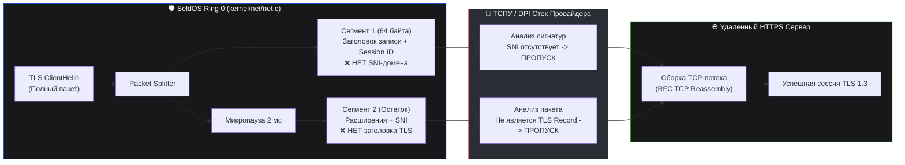
2. **Air-Gap Stealth Mode (`NET_AIRGAP_STEALTH`):**
   - **Zero-Emission Boot:** При загрузке ОС не излучает ни одного широковещательного или зондирующего пакета.
   - **Блокировка открытого DNS (порт 53):** Провайдерский перехват UDP DNS невозможен; ядро блокирует открытые запросы с кодом `-10`, и `libsnl` автоматически переключается на DoT (порт 853) через TLS 1.3 с активным TCP desync.
   - **ICMP Silent Guard:** Подавление исходящих пингов предотвращает составление провайдером профиля активности хоста.
3. **Нативный C99 VLESS Клиент (`/bin/stealth vless`):**
   - Полная реализация протокола VLESS на чистом C без зависимостей от внешних скриптов.
   - Поддержка шифрования TLS 1.3 через SeldTLS с кастомным SNI и маскировкой.
   - Прямое установление защищенного туннеля через TCP сокеты ядра.

#### Команды управления в Shell:
- `stealth status` или `net status` — просмотр текущего статуса Air-Gap Shield и режима TCP Desync.
- `stealth on` или `net stealth` — мгновенное включение режима максимальной скрытности.
- `stealth desync split` или `desync split` — активация сегментации SNI.
- `stealth desync fake` — включение режима внедрения ложных сегментов.
- `stealth vless <ip> <port> <uuid> <target_host> <target_port> [sni]` — подключение к VLESS-прокси.

<p align="center">
  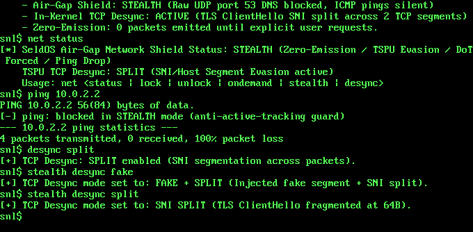<br>
  <i>Верификация работы стелс-режима, блокировки ICMP и In-Kernel TCP Desync в SeldOS</i>
</p>

---

## 7. Мобильный DOOM и сенсорное управление (Virtual Touch HUD)

В SeldOS встроен автономный сенсорный оверлей для терминала и 3D-шутера DOOM, позволяющий полноценно работать и играть на смартфонах и планшетах без подключения аппаратной клавиатуры:

```
+-------------------------------------------------------------------------+
| [ESC]  [MAP]  [ENTER]    [< WPN]  [WPN >]                     [HUD:ON]  |  <- Верхняя панель
|-------------------------------------------------------------------------|
|                                                                         |
|                                                                         |
|                                                                         |
|       [ UP ]                                     [ RUN ]                |
|  [<STR]    [STR>]                             [USE]  [ FIRE ]           |
|  [LEFT]    [RIGHT]                                   [      ]           |
|      [DOWN]                                                             |
+-------------------------------------------------------------------------+
    ^ Левая рука (D-Pad + Стрейф)                 ^ Правая рука (Бой)
```

### Раскладка элементов управления:
- **Терминал (`/bin/sh`):**
  - Верхний ряд быстрых команд (Quick Bar): крупные сенсорные кнопки <kbd>DOOM</kbd> (запуск в 1 касание), <kbd>LS</kbd>, <kbd>PS</kbd>, <kbd>UNAME</kbd>, <kbd>HELP</kbd>, <kbd>CLEAR</kbd>, <kbd>PC</kbd> (мгновенное переключение в режим ПК), <kbd>BEEP</kbd>.
  - Полноразмерная QWERTY-клавиатура (цифровой ряд, латиница, знаки препинания, <kbd>SPACE</kbd>, <kbd>BKSP</kbd>, <kbd>ENTER</kbd>).
  - При нажатии клавиш выдаётся звуковой отклик через спикер.
- **В игре DOOM:**
  - **Левая рука (движение):** виртуальный D-Pad (<kbd>UP</kbd>, <kbd>DOWN</kbd>, <kbd>LEFT</kbd>, <kbd>RIGHT</kbd>) и стрейф (<kbd>&lt; STR</kbd>, <kbd>STR &gt;</kbd>). На физической клавиатуре: <kbd>W</kbd>, <kbd>A</kbd>, <kbd>S</kbd>, <kbd>D</kbd> / стрелки навигации.
  - **Правая рука (действие):** кнопки <kbd>FIRE</kbd> (или клавиша <kbd>Ctrl</kbd>), <kbd>USE</kbd> (или <kbd>Space</kbd>), <kbd>RUN</kbd> (или <kbd>Shift</kbd>).
  - **Верхняя сервисная панель:** <kbd>ESC</kbd>, <kbd>MAP</kbd> (<kbd>Tab</kbd>), <kbd>ENTER</kbd>, переключение оружия <kbd>&lt; WPN</kbd> / <kbd>WPN &gt;</kbd> (<kbd>1</kbd>–<kbd>7</kbd>), переключатель <kbd>HUD:ON</kbd> / <kbd>HUD:OFF</kbd>.
  - В режиме ПК (`pc`) все экранные кнопки DOOM автоматически скрываются.

> [!TIP]
> **Переключение между сенсорным и десктопным режимом:** В консоли шелла команда `pc` мгновенно скрывает экранную клавиатуру, переключая видеорежим на полноэкранный терминал $85 \times 20$ символов (320 px). Обратная команда `mobile` восстанавливает 12-строчную консоль со сенсорными кнопками и D-Pad.

## 8. Запуск на ПК (BIOS / Live USB) и мобильных устройствах

Все компоненты ОС (загрузчик, ядро, юзерспейс, утилиты и файловая система SeldFS) упакованы в **один компактный файл `build/seldos.iso`** (**3.6 МБ**). Никаких дополнительных жестких дисков подключать не требуется.

### 8.1. Запуск на физическом ПК через BIOS (Live USB / Bare Metal)

Образ `build/seldos.iso` собирается в формате **Hybrid ISO** с MBR-загрузчиком GRUB 2 (`i386-pc-eltorito` + `boot_hybrid.img`), что обеспечивает прямую загрузку на физических материнских платах с **Legacy BIOS** или **UEFI в режиме CSM**. Система загружается в оперативную память (RAMDISK) целиком — наличие подключенного жесткого диска не требуется.

#### 1. Запись на USB-флешку:
- **В Linux / macOS через терминал:**
  ```bash
  # Замените /dev/sdX на идентификатор вашей флешки (например, /dev/sdb)
  sudo dd if=build/seldos.iso of=/dev/sdX bs=4M status=progress conv=fsync
  ```
- **В Windows через Rufus:**
  1. Выберите вашу USB-флешку и укажите файл `seldos.iso`.
  2. Схема раздела: **MBR**, целевая система: **BIOS (или UEFI-CSM)**.
  3. При нажатии «СТАРТ» **обязательно** выберите пункт: **«Запись в режиме DD-образ»** (DD Image mode).

#### 2. Настройки BIOS / материнской платы:
- **CSM / Legacy Boot:** **Включено (Enabled)**.  
  > [!IMPORTANT]
  > Чистый UEFI без модуля CSM не запустит MBR-образ `i386-pc`. В настройках BIOS материнской платы (раздел *Boot*) переключите режим с *UEFI Only* на *Legacy Support* или *CSM (Compatibility Support Module) Enabled*.
- **Secure Boot:** **Отключено (Disabled)** (самописное суверенное ядро и GRUB не содержат закрытых ключей подписи Microsoft).
- **Порядок загрузки (Boot Priority):** Выставьте USB-накопитель на первое место в списке загрузки или вызовите меню быстрой загрузки клавишами `F8`, `F11` или `F12` при старте ПК.

#### 3. Системные требования (минимальные и комфортные):

| Компонент | Минимальные (абсолютный минимум) | Комфортные (рекомендуемые) |
| :--- | :--- | :--- |
| **Процессор (CPU)** | 1 ядро 64-bit x86_64 (Athlon 64 / Core 2 Duo, от 300–500 МГц) или RISC-V RV64GC (от 100 МГц). Без обязательного SSE ядром. | 2+ ядра x86_64 от 1.5 ГГц (Intel Core / AMD Ryzen) с аппаратным RDTSC/RDRAND для криптографии. |
| **Оперативная память (RAM)** | **4 МБ** (Ring 0 шелл / ATA) / **5–6 МБ** (Ring 3 SNL `/bin/init` + `/bin/sh` с Live CD) / **12–16 МБ** (с запуском DOOM). | **128–512 МБ** (полное расширение SeldFS в ОЗУ до 34 МБ R/W, SeldTLS 1.3, Tor, DOOM и Oracle). |
| **Видеопамять / Экран** | **1 МБ VRAM** (VBE/VESA 2.0+ LFB или BGA, фреймбуфер $680 \times 334 \times 32$ bpp занимает всего **887.2 КиБ**). | Любой GPU (Intel HD, Radeon, GeForce, QEMU BGA, VBoxVGA) с аппаратным LFB. |
| **Накопитель (Storage)** | **4–8 МБ** (ISO весит **3.6 МБ**, ядро — **367 КБ**, образ ФС — **2.69 МБ**). Жесткий диск не требуется (100% RAMDISK). | USB-флешка от **64 МБ до 1 ГБ** (для удобной записи через `dd`/Rufus в режиме DD-образа). |
| **Материнская плата** | Legacy BIOS или UEFI с модулем CSM (Compatibility Support Module). Secure Boot: **Отключен**. | Legacy BIOS / UEFI CSM. Secure Boot: **Отключен**. |
| **Звуковая карта** | Встроенный системный динамик (PC Speaker, PIT Ch2, порт 0x61). | Intel ICH AC'97 (82801AA) или Sound Blaster 16 (непрерывный 48 кГц DMA-звук). |
| **Сетевая карта** | Не требуется (система автономна и изолирована). | Intel PRO/1000 Gigabit Ethernet (контроллер `e1000`, 82540EM) для Tor и Anti-DPI. |

##### Градация потребления оперативной памяти (RAM Tiers):
- **4 МБ RAM (Абсолютный минимум ядра):** Humboldt Kernel успешно инициализирует все 8 подсистем (GDT/IDT, PMM, VMM W^X, ATA, SeldFS, PIT, Crypto CSPRNG, Scheduler, e1000). При исчерпании свободных фреймов ядро штатно переходит в супервизорный аварийный шелл `seldshell#` (Ring 0), а при наличии ATA-диска сразу запускает Ring 3.
- **5–6 МБ RAM (Минимум пользовательского режима с Live CD):** Полный запуск супервизора Ring 3 `/bin/init` (PID 1) и суверенной командной оболочки SNL `/bin/sh` при чистой ISO-загрузке.
- **12–16 МБ RAM (Запуск 3D-гейминга):** Достаточно для распаковки `doom1.wad` (4.2 МБ), инициализации видеопамяти (887.2 КиБ) и адаптивного пула Zone Memory DOOM (4 МБ).
- **64–128 МБ RAM (Штатный рабочий режим):** Поддерживается разреженная запись On-Demand до **34 МБ (Read/Write)**. Обеспечивается работа сетевого стека, TLS 1.3 рукопожатий и браузера Tor.
- **256–512+ МБ RAM (Максимальный комфорт):** Запас памяти «на века» для длительных сессий, многозадачности и мгновенного вайпа ОЗУ (DoD RAM Wipe) при сбросе сессии.

- **[!] Dead Man's Grip (Удержание SHIFT):**  
  > [!WARNING]
  > В системе активна защита от перехвата управления. При переходе в пользовательскую сессию удерживайте клавишу `Shift`. Если отпустить клавишу, активный защитный контур ядра расценит это как захват терминала и выполнит мгновенный сброс сессии и вайп ОЗУ.

### 8.2. Настройка в Android (Limbo x86)

<details>
<summary><b>📱 Развернуть пошаговую инструкцию для Android (Limbo x86)</b></summary>

1. Установите **Limbo x86** (версия для x86_64 PC, не ARM!).
2. Скопируйте файл `seldos.iso` в память смартфона.
3. Создайте новую виртуальную машину (**New** -> **Custom**):
   - **Board / CPU:**
     - **Machine Type:** `pc` (Standard PC i440FX)
     - **CPU Model:** `qemu64`
     - **CPU Cores:** `2` (или `1`)
     - **RAM Memory (MB):** `256` или `512`
   - **Storage / Disks:**
     - **Hard Disk:** `None` (снять галочки)
   - **Removable:**
     - **CDROM:** Поставить галочку -> выбрать `seldos.iso`
   - **Boot:**
     - **Boot from Device:** `CDROM`
   - **Graphics:**
     - **Video Display:** `std` (Standard VGA)
     - **Audio / Network:** `None`
   - **User Interface:**
     - **Interface:** `SDL`
     - **Orientation:** `Landscape`
     - **Fullscreen:** Включено
     - **Mouse Mode:** `Touchscreen` (или `Trackpad`)
4. Нажмите **Play** (зеленый треугольник) — система стартует мгновенно, и сразу откроется DOOM с наэкранным пультом.

</details>

### 8.3. Настройка в iOS (UTM)

<details>
<summary><b>🍏 Развернуть пошаговую инструкцию для iOS / iPadOS (UTM)</b></summary>

1. Создайте виртуальную машину: **Create a New Virtual Machine** -> **Emulate**.
2. Архитектура: **x86_64**.
3. Память RAM: `256 MB` или `512 MB`.
4. В разделе Drives: добавьте съемный накопитель (CD/DVD) и выберите `seldos.iso`.
5. В разделе Input выберите режим **Direct Touch**.

</details>

### 8.4. Настройка в VirtualBox (ПК)

> [!CAUTION]
> **Критический выбор аудиоконтроллера:** По умолчанию VirtualBox выбирает *Intel HD Audio*, не поддерживаемый SeldOS. Чтобы слышать звук и музыку Оракула, обязательно переключите аудиоконтроллер на **ICH AC97**! VirtualBox не эмулирует PC Speaker напрямую в хост-систему, поэтому ядро Humboldt осуществляет непрерывный DMA-синтез в 48 кГц стереобуфер именно через эмулятор контроллера Intel 82801AA AC'97.

1. Создайте новую виртуальную машину (**New**):
   - **Имя и тип ОС:** Type: `Other`, Version: `Other/Unknown (64-bit)`.
   - **Оперативная память (RAM):** `512 MB` (или `1024 MB`).
   - **Процессор (CPU):** 1 или 2 ядра.
2. В разделе **Носители (Storage)**:
   - Выберите оптический привод (IDE/SATA) -> укажите файл образа `build/seldos.iso`.
3. В разделе **Аудио (Audio)**:
   - Поставьте галочку **«Включить аудио»** (`[x]`).
   - **Аудиодрайвер хоста (Host Audio Driver):** выберите `PulseAudio` (для Linux хостов с PulseAudio/PipeWire) или `ALSA`.
   - **Аудиоконтроллер (Audio Controller):** выберите строго **ICH AC97**!
   - Поставьте галочку **«Включить аудиовыход»** (`[x]`).
4. В разделе **Сеть (Network)**:
   - Тип подключения: **NAT**.
   - Адаптер (в расширенных свойствах): **Intel PRO/1000 MT Desktop (82540EM)** (драйвер `e1000` в ядре) или **PCnet-FAST III**.
5. Запустите виртуальную машину — система загрузится мгновенно через графическую анимацию инициализации.

---

## 9. Сборка и тестирование на ПК

### 9.1. Системные требования для сборки:
- Компилятор: `gcc` (поддержка x86_64, freestanding).
- Ассемблер: `nasm` (версия 2.14+).
- Линкер: GNU `ld`.
- Утилиты образов: `grub-mkrescue`, `xorriso`.
- Эмулятор для тестирования: `qemu-system-x86_64`.
- Интерпретатор: `python3`.

### 9.2. Команды сборки и запуска:

> [!TIP]
> **Быстрый старт (One-Liner):** Для мгновенной компиляции всех модулей, сборки дистрибутивного ISO и запуска в QEMU со звуком AC'97 и сетью выполните:
> ```bash
> make all && make qemu
> ```

```bash
# 1. Полная сборка ядра, libc, утилит, DOOM и создание единого ISO
make all

# 2. Запуск в QEMU со встроенной сетью E1000 и автоматическим стартом OpSec Gateway
make qemu

# 3. Запуск в QEMU с эмуляцией Intel AC'97, PC Speaker и сетевой картой E1000
qemu-system-x86_64 -cdrom build/seldos.iso -m 512M -device AC97,audiodev=audio0 -audiodev pa,id=audio0 -machine pcspk-audiodev=audio0 -net nic,model=e1000 -net user -serial stdio -vga std

# 4. Управление фоновым OpSec Gateway вручную
python3 scripts/opsec_gateway.py --status   # Проверка статуса
python3 scripts/opsec_gateway.py --daemon   # Запуск демона на порту 8080
python3 scripts/opsec_gateway.py --stop     # Остановка демона

# 5. Автоматизированные тесты иммунной системы, OpSec и сетевого стека
python3 tests/verify_unveil_jitter.py    # Комплексный тест SYS_UNVEIL sandboxing и THL Keystroke Jitter
python3 tests/verify_stealth_evasion.py  # Комплексный тест Anti-TSPU/DPI, TCP Desync и /bin/stealth
python3 tests/verify_opsec_hardening.py  # Комплексный тест всех 6 механизмов OpSec Hardening
python3 tests/verify_immune.py           # Комплексный тест Air-Gap, purge и Zero-Trust защиты
python3 tests/verify_net.py              # Тест нативного TCP/IP стека ядра и E1000 NIC

# 6. Очистка артефактов сборки
make clean
```

### 9.3. Порт на архитектуру RISC-V 64-bit (RV64GC / Sv39 MMU)

SeldOS поддерживает независимый, чистый кросс-архитектурный порт под процессорную архитектуру **RISC-V 64-bit (RV64GC)** с аппаратной защитой памяти, трехуровневым MMU (Sv39), изоляцией пользовательского пространства (Supervisor S-Mode / User U-Mode), быстрым `ecall` интерфейсом системных вызовов и монтированием файловой системы SeldFS.

#### Ключевые архитектурные характеристики порта RISC-V:
- **Базовый ISA & расширения (RV64GC):**
  - Поддержка набора инструкций `RV64IMAFDC` (64-битный базис, аппаратное умножение/деление, атомарные операции A, числа с плавающей запятой одинарной и двойной точности F/D, 16-битные сжатые инструкции C).
  - Модель привилегий RISC-V:
    - **M-Mode (Machine Mode):** Слой прошивки OpenSBI (стандартный виртуальный BIOS QEMU `virt`).
    - **S-Mode (Supervisor Mode):** Ядро SeldOS Humboldt RV64 (`0x80200000`).
    - **U-Mode (User Mode):** Пространство приложений SNL (`0x0000000000400000`).
- **Sv39 Virtual Memory Management (MMU):**
  - 3-уровневая структура таблиц страниц (VPN[2], VPN[1], VPN[0] по 9 бит, 4 KiB страница).
  - 39-битное виртуальное адресное пространство (до 512 GiB) с контролем бита `satp` (MODE = 8).
  - Строгое соблюдение **W^X**: страницы `.text` ядра и userspace помечаются `PTE_R | PTE_X`, страницы данных и стека `PTE_R | PTE_W` (без бита `PTE_X`).
  - Разделение прав: биты `PTE_U` выставляются строго для userspace страниц, предотвращая выполнение непривилегированного кода с правами супервизора (аналог SMAP/SMEP).
  - Карта памяти RISC-V: физическая память начинается с `0x80000000`, ядро загружается по адресу `0x80200000`, пользовательские процессы стартуют с `0x0000000000400000`, стек пользователей размещается в верхних адресах.
- **Диспетчеризация ловушек и быстрые системные вызовы (`ecall`):**
  - Вектор прерываний и ловушек настраивается через регистр `stvec` на низкоуровневый обработчик `trap_entry.S`.
  - Системные вызовы инициируются инструкцией `ecall` из Ring 3 (U-Mode):
    - Номер системного вызова передается в регистре `a7`.
    - Аргументы передаются в `a0`–`a4`.
    - Результат возвращается в `a0`.
    - При возврате из ловушки (`sret`) регистр `sepc` инкрементируется на 4 байта (`sepc += 4`).
- **Драйверы и таймеры платформы QEMU virt:**
  - **UART 16550A:** MMIO-драйвер последовательного порта по адресу `0x10000000` (`kernel/drivers/serial.c`) с прерываниями и прямой буферизацией терминала.
  - **SBI Timer & Clock:** Прерывания таймера через вызовы `sbi_ecall` (SBI Extension ID `0x00`, Function ID `0x00` — `sbi_set_timer`) для квантования планировщика и задержек.
  - **Встроенное хранилище SeldFS:** Диск с userspace-бинарниками и системными файлами компилируется в ELF как объектный блоб (`disk_blob.S`) и монтируется виртуальным блочным драйвером Ramdisk на старте ядра.
- **Пользовательский рантайм `libsnl` под RISC-V:**
  - Собственная реализация точки входа `userspace/crt0_riscv64.S`.
  - Специфичный линкерный скрипт `userspace/linker_riscv64.ld`.
  - Сборка нативного userspace набора (`/bin/init`, `/bin/sh`, `/bin/ls`, `/bin/cat`, `/bin/download`, `/bin/tor` и др.) компилятором `riscv64-linux-gnu-gcc` в чистом freestanding-режиме без glibc.

```bash
# 1. Сборка ядра и диска под RISC-V 64-bit
make riscv

# 2. Интерактивный запуск в QEMU (S-mode через OpenSBI)
make qemu-riscv
# либо напрямую:
qemu-system-riscv64 -M virt -m 128M -nographic -bios default -kernel build/kernel-riscv64.elf

# 3. Запуск автоматизированного интеграционного набора тестов RISC-V
python3 tests/verify_riscv.py
```

---

## 10. Лицензия и суверенный манифест

Ядро **Humboldt Kernel**, библиотека **`libsnl`** и набор утилит пользовательского пространства **SNL** распространяются на условиях лицензии **GNU Affero General Public License v3 (AGPLv3)** с суверенным райдером (**Humboldt Underground Sovereign Rider**):
- **Сетевой копилефт (Section 13 AGPLv3):** Любое сетевое использование или предоставление сервиса через облако, VPS или Tor обязывает оператора предоставлять 100% исходного кода всем подключившимся пользователям.
- **Анти-корпоративный и анти-государственный запрет:** Исходный код SeldOS категорически запрещен к использованию спецслужбами (ЦРУ, АНБ, ФСБ и их подрядчиками), операторами DPI/ТСПУ/СОРМ, разработчиками систем слежки и закрытыми корпоративными монополиями.
- **Запрет коммерческого релицензирования:** Никакие закрытые коммерческие лицензии или исключения никогда не продаются. Код навсегда принадлежит андерграунду.
- **Сторонние компоненты (Third-Party):** Изолированный порт DOOM (`userspace/doom`) лицензирован на условиях оригинальной лицензии **GNU GPLv2** (Copyright (C) id Software).

Полный текст лицензии и манифеста доступен в файле [`LICENSE`](LICENSE).
